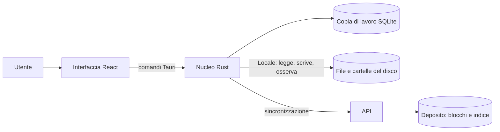

# Architettura

<!-- Fase 7 della guida. Ogni scelta tecnologica è una decisione nel registro. -->

## Scelte tecnologiche
| Ambito | Scelta | Decisione |
|---|---|---|
| App desktop (Windows, macOS) | Tauri 2: interfaccia web in TypeScript, parte nativa in Rust | DEC-23 |
| Interfaccia | React con TypeScript | DEC-26 |
| Editor della nota | CodeMirror 6, uno solo. Vista Testo: testo puro; vista Markdown: un compartimento con `@codemirror/lang-markdown` e la resa a simboli nascosti (vedi «Vista della nota») | DEC-27, DEC-64, DEC-130 |
| Barra di scorrimento | OverlayScrollbars (`overlayscrollbars`, `overlayscrollbars-react`) per la barra sottile sovrapposta al contenuto (CMP-25) | DEC-89 |
| Icone e carattere | `lucide-react` per le icone Lucide; Inter incorporato nell'app con `@fontsource-variable/inter`, così non dipende dai caratteri installati | DEC-15, tokens.md |
| Token nel codice | Variabili CSS in `client/src/stili/token.css`, stili di testo come classi in `client/src/stili/base.css`; il modo chiaro o scuro segue il sistema | DEC-21, DEC-22 |
| Server (API) | Node con TypeScript e Fastify | DEC-24, DEC-32 |
| Archivio del server | PostgreSQL: Neon in rete, PGlite (Postgres nel processo) in locale e nelle prove; blocchi cifrati sul dispositivo (DEC-121; oggi ancora in chiaro, DEC-78) | DEC-105 |
| Copia di lavoro nel client | Note, tag, cartelle e cestino in un database SQLite nel nucleo Rust del client (rusqlite), file `copia-di-lavoro.db` nella cartella dei dati delle applicazioni; l'interfaccia lo legge e scrive con comandi Tauri, uno per endpoint descritto in `api.md`, con gli stessi dati e codici di errore. Il client funziona senza API. Alla prima apertura parte da una copia di `memodu.db` dell'API, se c'è nella stessa cartella | DEC-67 (proposta) |
| Server (deposito della sincronizzazione) | L'API non gestisce più le note: conserva solo i blocchi della sincronizzazione e le loro versioni (DEC-75, DEC-85); conosce solo i dati dell'utente fisso che non permettono di leggere le note (DEC-121) | DEC-85 |
| File locali (RF-17) | Nel nucleo Rust (`locale.rs`): `tauri-plugin-dialog` per scegliere la cartella, `notify` per i cambi sul disco, `sha2` per l'impronta, `encoding_rs` per Windows-1252, `trash` per il Cestino del sistema; niente va sul server | DEC-118 |
| Hosting | Vercel, funzione con Fastify senza configurazione, solo HTTPS; regione Francoforte | DEC-104, DEC-105 |

## Struttura del repository
Un solo repository con workspace npm (DEC-33); client e API si avviano separatamente (DEC-67):

| Cartella | Contenuto |
|---|---|
| `client` | App desktop: interfaccia React in `src`, nucleo Rust di Tauri in `src-tauri` con la copia di lavoro (DEC-67). Si avvia con `npm run client` |
| `api` | API in Fastify. Si avvia da sola con `npm run api` |
| `condiviso` | Tipi dei dati dei comandi del nucleo (per esempio la Nota) e limite delle note, per l'interfaccia. Il server non lo usa mentre gira: su Vercel non può importare sorgenti TypeScript di un altro pacchetto, quindi indirizzo e limiti del server stanno in `api/src/costanti.ts` (DEC-105) |

Prove con Vitest, controllo del codice con ESLint e Prettier.

## Schema del database (DEC-48)
SQLite nella copia di lavoro del client (DEC-67, DEC-85; prima nell'API, DEC-46, DEC-47). Qui le tabelle di Must A, B e C; sincronizzazione (schema 2), impostazioni (schema 3 e 4) e indice di ricerca (schema 5, sotto) hanno le loro sezioni; immagini e avvisi arrivano con i loro frammenti.

| Tabella | Colonne principali | Regole |
|---|---|---|
| `note` | id, titolo, contenuto (markdown), cartella, creata, creata scelta, modificata, fine validità, eliminata il, provenienza | Una sola cartella o nessuna (RF-05); nel cestino se «eliminata il» è compilato (DEC-37) |
| `cartelle` | id, nome, chiave del nome, cartella madre, eliminata il, provenienza | Nome unico tra le sorelle senza maiuscole (RB-23); nel cestino con tutto il contenuto (RB-25) |
| `tag` | id, nome come scritto la prima volta, chiave del nome, tag padre | Unico senza maiuscole (RB-22); un livello per tag (RB-18); i sotto-tag seguono il padre (RB-19) |
| `note_tag` | nota, tag | Un tag può restare senza note (RB-49) |

- La chiave del nome è il nome in minuscolo calcolato dal nucleo, perché il confronto di SQLite ignora le maiuscole solo senza accenti.
- Istanti in ora universale ISO 8601, date del calendario come giorno. La versione dello schema è segnata nel database.

## Indice di ricerca (RF-08, DEC-94, DEC-95)
- **Dove:** schema 5 della copia di lavoro (lo schema 4 aggiunge l'impostazione), tabella virtuale FTS5 `ricerca` con il tokenizzatore `trigram remove_diacritics 1` (SQLite 3.50, incluso in rusqlite con FTS5). Colonne: `id` della nota (non indicizzata), `titolo`, `contenuto`, `tag` (i percorsi completi dei tag della nota, separati da a capo).
- **Aggiornamento:** trigger su `note`, `note_tag` e `tag`, che valgono anche per le modifiche ricevute dalla sincronizzazione (compresa l'unione di due tag doppi); la tabella `ricerca_righe` lega ogni nota alla sua riga dell'indice, così un salvataggio non scorre tutto l'indice; il trigger sui tag scatta solo se nome o padre cambiano davvero; i percorsi li dà la funzione SQL `tag_della_nota`, registrata da Rust. Alla migrazione l'indice si riempie con le note che ci sono.
- **Ricerca:** dalla terza lettera l'indice, con ogni parola tra virgolette (il testo non è mai una query, RB-08); con una o due lettere si scorrono le note con la funzione SQL `normalizza` (minuscole, senza accenti). Filtri, ordine ed estratto in Rust (`client/src-tauri/src/archivio_ricerca.rs`).
- **Impostazione:** colonna `cestino_in_ricerca` della tabella `impostazioni`, sincronizzata (RB-52).

## Regole dei dati (frammento Must D, DEC-49)
Le regole stanno solo nella copia di lavoro del client (`client/src-tauri/src/archivio.rs`, file `copia-di-lavoro.db`, DEC-67, DEC-85): l'API non ha più un archivio delle note. Nella copia di lavoro ogni operazione è una transazione.

- **Nomi delle cartelle** (RB-63): i caratteri vietati nei nomi dei file (`< > : " / \ | ? *` e i caratteri di controllo) diventano `-`, senza punti e spazi finali, al massimo 100 caratteri; i nomi riservati di Windows (`CON`, `PRN`, `AUX`, `NUL`, `COM1`…, `LPT1`…) ricevono un `-` in fondo. Maiuscole e minuscole non contano (RB-23). Confermato da Manuel Cucca il 28/09/2026.
- **Titoli delle note:** si ripetono liberamente (RB-16); non servono più numeri per distinguere i file.
- **Anteprima nell'elenco** (RB-15): le prime parole del contenuto senza simboli markdown, al massimo 80 caratteri. Confermato da Manuel Cucca il 28/09/2026.
- **Cestino** (DEC-37, DEC-48): eliminare segna «eliminata il» sulla nota o sulla cartella; una cartella eliminata porta con sé tutto il contenuto, che non si apre più finché non torna. Ripristinare la riporta nella radice (RB-28); eliminare per sempre cancella la riga e, per una cartella, tutto il contenuto, tranne gli elementi eliminati a parte, che restano nel cestino. Quando un'unione svuota una cartella, la cartella sparisce anche se nel cestino ci sono elementi che venivano da lì: si staccano e restano ripristinabili nella radice.
- **Riconnessione:** ogni operazione dell'archivio passa da un'unica funzione (`con_riconnessione`): se SQLite risponde che il file è in sola lettura, la connessione si riapre e l'operazione si riprova una volta, così quando il file torna scrivibile non serve riavviare l'app. Scelta di Manuel Cucca il 29/09/2026.
- **Dove:** la cartella dei dati delle applicazioni (DEC-46); la variabile d'ambiente `MEMODU_CARTELLA` la sostituisce (prove e sviluppo).

## Vista della nota (RF-02, DEC-130, 1.1.0)
- **Copia di lavoro:** schema 7, `ALTER TABLE note ADD COLUMN vista TEXT`, con i valori `testo` e `markdown`; vuota vale Testo, così le note scritte prima della 1.1.0 non cambiano (RB-91). Il nucleo crea con `markdown` le note nuove (Nuova nota, Ctrl + N, nota rapida); la copia in conflitto prende la vista dell'originale.
- **Comando:** `cambia_vista(id, vista)`; il tipo `Nota` in `condiviso` riceve `vista`. Cambiare la vista non tocca «modificata» e non sposta la nota nell'elenco (RB-91); il trigger della sincronizzazione la segna comunque da inviare.
- **Sincronizzazione:** `vista` entra nei `campi` del blocco solo se c'è; un blocco ricevuto senza `vista` non cambia quella che c'è, sia applicandolo sia nella fusione (RB-92). Per il resto è un campo come gli altri, vince la modifica arrivata per ultima (DEC-109). Il server non cambia; il nome non può essere `formato`, che nei blocchi indica la cifratura (DEC-78).
- **Editor:** in `Editor.tsx` la vista Markdown è un compartimento di CodeMirror che si cambia senza ricreare l'editor: `markdown({ base: markdownLanguage })`, la resa che nasconde i simboli (da `anteprima.ts`, con i simboli come intervalli atomici, CA-02.15), la casella della checklist cliccabile (CA-02.20) e i tasti di CA-02.17 e CA-02.18 (`insertNewlineContinueMarkup` e `deleteMarkupBackward` della libreria per gli elenchi, poco codice nostro per i titoli e per il testo scritto ai bordi di un pezzo formattato, CA-02.16). Niente menu «/», tasto destro né scorciatoie; la bollicina del formato è nella sezione sotto (DEC-131).
- **Dove:** nota aperta e nota rapida con la vista della nota; file di Locale con la vista dall'estensione (CA-17.25); in Info `SceltaSegmenti` chiama `cambia_vista`.

## Bollicina del formato (RF-02, DEC-131, 1.1.0)
Approvata da Manuel Cucca il 09/10/2026. L'editor resta CodeMirror (DEC-131, aggiornamento del 09/10/2026): la vista Testo e i file `.txt` non cambiano, perché tutto quello che segue vive nel compartimento della vista Markdown. Le scorciatoie (CA-02.3, CA-02.5) sono rinviate: si usa il mouse.

- **Cosa mostra (CA-02.4):** una funzione pura `formatoDove(state)` in `formati.ts` dice il formato della riga (testo, titolo, sottotitolo, puntato, numerato, casella, oppure misto se le righe toccate sono diverse) e i formati di carattere che coprono tutta la selezione, o la parola sotto il cursore. Legge l'albero del Markdown che la libreria costruisce già (`StrongEmphasis`, `Emphasis`, `Strikethrough`, le coppie `<u>` `</u>`), come `scrittura.ts` e `anteprima.ts`. L'editor la chiama a ogni cambio di testo o di selezione e la passa fuori con `onFormato`; in vista Testo passa `null` e la bollicina non c'è.
- **Comandi (CA-02.21 … CA-02.23):** in `formati.ts`, sullo stato, così si provano senza il DOM come quelli di `scrittura.ts`. `impostaRiga(formato)` (c'è già) mette, cambia o toglie il segno all'inizio delle righe toccate; «testo normale» lo toglie. `alternaCarattere(formato)` lavora sull'albero: se il formato copre già tutta la selezione lo toglie, spezzando il pezzo ai bordi della selezione; altrimenti lo mette, unendo i pezzi uguali che tocca, così i simboli non restano mai a metà. Senza selezione: dentro una parola vale per la parola (`state.wordAt`); tra due parole o in fondo alla riga accende un **formato in attesa**. `rimuoviFormattazione` toglie i segni di riga e tutti i simboli di carattere nella selezione o nella parola. Il vecchio `alternaFormato` di `comandi.ts`, che guarda solo i caratteri accanto alla selezione, non si usa.
- **Formato in attesa (CA-02.22):** un campo di stato con i formati accesi o spenti per il testo che si scrive dopo. Il primo carattere scritto entra già dentro i simboli (`**a**`); da lì lo tiene dentro la regola di `scrittura.ts`, perché il testo scritto in fondo a un pezzo formattato ne prende il formato. Spento in fondo a un pezzo, il testo nuovo va dopo i simboli di chiusura. Il campo si svuota quando il cursore si sposta senza scrivere. Risolve anche il caso di TC-10.
- **Sottolineato:** si scrive `<u>…</u>` (DEC-28); `anteprima.ts` lo nasconde già. `scrittura.ts` impara a trattare la coppia `<u>` `</u>` come gli altri pezzi formattati, per il cursore, la scrittura ai bordi e le cancellazioni.
- **`-[]` (CA-02.24):** un filtro della scrittura in `scrittura.ts`: a inizio riga, chiudendo `-[]`, la riga diventa `- [ ] `. `- ` e `1. ` restano della libreria.
- **Interfaccia:** un componente `Bollicina.tsx` (CMP-10) in `client/src/componenti/` con il formato da mostrare, il lato del cassetto e la scelta di una voce; il cassetto resta aperto finché si riprende a scrivere, con Esc, con un clic fuori o con un altro clic sulla bollicina (CA-02.21). Le voci usano il pulsante della pillola che c'è già (`Pillola.tsx`), con il suggerimento del nome (`Suggerimento.tsx`). L'editor espone un comando `applica(voce)` (riferimento React): applica il comando, rimette il focus nel testo e lascia il cursore e la selezione dove erano. La bollicina non prende il focus mentre si scrive.
- **Dove (CA-02.25):** nella nota aperta e nei file `.md` di Locale la bollicina è nel foglio, galleggiante in basso a destra (livello 20), e il testo ha in fondo il margine che le lascia spazio (80); nella nota rapida è nella fascia delle azioni subito a sinistra di Chiudi. Il cassetto si apre verso sinistra, sopra la pagina senza spostare niente, e va su due righe se dalla bollicina al bordo non c'è posto. `NotaAperta.tsx`, `NotaRapida.tsx` e `FileAperto.tsx` la mettono solo con `markdown` acceso.
- **Restano scollegati:** `EditorMarkdown.tsx`, la vecchia pillola sopra la selezione e i tasti di `comandi.ts`, fino al rinvio delle scorciatoie.

## Sincronizzazione (RF-10, Fase 7 completa, codice del 30/09/2026)
- **Codice:** server in `api/src/sincronizzazione.ts`; client in `client/src-tauri/src/sincronizzazione.rs` (il filo in background) e `archivio_sinc.rs` (blocchi, fusione e conflitti); schema 2 della copia di lavoro con i trigger che segnano gli elementi modificati. Se una modifica ricevuta cambia la nota aperta mentre la finestra ha ancora il testo vecchio, il testo della finestra va in una copia in conflitto e non la sovrascrive (DEC-06).
- **Unità:** un blocco per elemento (nota, cartella, tag, impostazioni; gli avvisi restano sul dispositivo, DEC-90, DEC-91), con dentro i suoi collegamenti; il server conosce solo identificativo, versione, dimensione e ora, e tiene anche le versioni precedenti di ogni blocco. Confronti e conflitti li risolve il client (DEC-75).
- **Modifiche e conflitti:** versione per blocco e numero d'ordine globale sul server; il dispositivo tiene la base di ogni elemento e confronta campo per campo; nei conflitti di RB-36 … RB-38 vince la modifica arrivata per ultima al server, cioè quella del dispositivo che fonde (DEC-109); le eliminazioni definitive diventano blocchi «eliminato» (DEC-76).
- **Versioni precedenti:** a scalare per 7 giorni (tutte nell'ultima ora, una all'ora nell'ultimo giorno, una al giorno fino a 7); la versione attuale resta sempre (DEC-77, DEC-113).
- **Cifratura (DEC-121, nucleo fatto il 06/10/2026):** il nucleo cifra ogni blocco con la chiave dati, XChaCha20-Poly1305 con un nonce casuale di 192 bit (crate `chacha20poly1305`) e l'id dell'elemento come dati aggiunti; il server vede solo blocchi illeggibili. Al primo accesso si rimanda tutto cifrato e il server cancella le versioni in chiaro (DEC-78, condizione 3). Dettagli in `architettura/api.md`.
- **Accesso (DEC-121):** vedi Sicurezza. Senza un gettone valido si lavora in locale e la finestra non si blocca (RB-87). Server fatto il 06/10/2026 (`api/src/accesso.ts`, `chiavi.ts`, `xchacha.ts`, `rotteAccesso.ts`, `utente.ts`); nucleo e interfaccia fatti lo stesso giorno (`client/src-tauri/src/accesso.rs`, `cifratura.rs`; `client/src/componenti/ModuloAccesso.tsx`, il box dell'account in `BoxAccount.tsx` con DEC-122, l'avviso in `FinestraPrincipale.tsx`). Il gettone statico del file `credenziali` delle app fino alla 0.1.8 (DEC-79, DEC-104) è stato tolto dal server il 07/10/2026: vale solo il JWT.
- **Server cambiato:** l'archivio del server ha un identificativo; se cambia, il client azzera versioni e numero d'ordine e rimanda tutto (`azzera_sinc`, DEC-105).
- **Quando:** all'avvio, qualche secondo dopo ogni salvataggio, ogni 30 s e al ritorno della rete; senza rete i tentativi si diradano da 5 s fino a 5 minuti (DEC-80).
- **Avviso:** «server irraggiungibile» dopo un'ora senza sincronizzazioni riuscite (RB-40, DEC-112).
- **Versioni di app e server:** ogni richiesta porta la versione del protocollo; se incompatibile, avviso «errore di sincronizzazione» e si continua sulla copia di lavoro (DEC-83).

## Account nel database (RF-14, RF-16, DEC-132, DEC-133; Fase 7 approvata il 14/10/2026)
**Modello dati fisico** (migrazione 2 dello schema del server, `api/src/schema.ts`):

| Tabella | Colonne | Chiavi e indici |
|---|---|---|
| `utenti` (EN-05) | `id` uuid, `email` text (minuscola), `sale` text, `argon2` text («memoria,passaggi,fili»), `impronta_accesso` text, `impronta_recupero` text, `chiave_password` text, `chiave_recupero` text, `creato_il` timestamptz | `id` chiave; `email` unica |
| `dispositivi` (EN-06) | `id` uuid, `utente` uuid, `impronta_gettone` text, `tipo` text («windows» o «macos»), `nome` text cifrato o null, `collegato_il` timestamptz, `ultima_sincronizzazione` timestamptz o null | `id` chiave; `utente` riferisce `utenti` con cancellazione a cascata; `impronta_gettone` unica |
| `versioni` | in più `utente` uuid, non nullo | chiave `(utente, id, versione)`; indice `(utente, ordine)` |

**Migrazione dell'utente fisso:** la migrazione 2 crea le tabelle; se nelle variabili d'ambiente c'è l'utente fisso (DEC-121), lo inserisce come primo account con gli stessi dati (stessa chiave dati: le note non si ricifrano) e gli assegna tutte le righe di `versioni`; poi rende `utente` obbligatorio. Con righe in `versioni` e senza utente fisso la migrazione si ferma con un errore. Dopo il rilascio, su Vercel restano `DATABASE_URL` e `MEMODU_SEGRETO`; le altre variabili `MEMODU_*` si tolgono (runbook).

**Sincronizzazione:** ogni lettura e scrittura filtra per l'account del gettone (RF-10): `modificheDopo(utente, n)` e `scrivi(utente, id, base, dati)`. Il numero d'ordine resta unico per tutto il database, così un account vede numeri crescenti ma non consecutivi, e il client non cambia; l'identificativo dell'archivio resta uno solo. Il blocco che mette in fila le scritture resta unico. A ogni lettura delle modifiche il server aggiorna `ultima_sincronizzazione` del dispositivo (RB-100).

**Cambio della password e recupero (FL-14):** la chiave dati non cambia mai; il dispositivo la riavvolge con la password nuova (e con la chiave di recupero nuova, se nasce) e il server scrive tutto in una transazione, insieme alla cancellazione degli altri dispositivi se richiesta. Una richiesta ripetuta dopo una risposta persa trova i dati già scritti e risponde come riuscita (SF-08).

**Risposta tecnica alle sfighe:** SF-01 il pulsante in caricamento e le richieste ripetibili; SF-08 e SF-10 le richieste ripetibili e la chiave nuova mostrata solo dopo la conferma; SF-20 lo scollegamento di un dispositivo già scollegato risponde `204`; SF-22 vale l'ultima transazione; SF-25 e SF-42 il `401` alla prima richiesta; SF-30 i messaggi del server non raggiungibile; SF-34 ogni richiesta è legata all'account del gettone, mai a un id mandato dall'app; SF-35 nessun limite durante la prova (rischio accettato, DEC-132).

**Ambienti:** gli stessi di oggi (`architettura/ambienti.md`): locale con un database Postgres di prova e `api/.env`; prova e produzione sono il database Neon e il server su Vercel di oggi (DEC-132). Le prove del server girano su un database effimero.

## Brainet (RF-18, DEC-134; Fase 7 approvata da Manuel Cucca il 15/10/2026)
Brainet vive tutto nel client, come le note: copia di lavoro, comandi del nucleo, sincronizzazione a blocchi cifrati. Il server non cambia.

**Pillole e aree dentro il testo (scelta di Manuel Cucca del 15/10/2026).** Il testo di una nota Brainet è Markdown con due segni in forma di tag, come `<u>` per il sottolineato (DEC-28):
- collegamento (EN-14): `<cita e="ID">Luca Bianchi</cita>`; dentro c'è il nome com'era quando è stato scritto, che serve solo se l'entità non c'è più; la pillola mostra il nome attuale dell'entità;
- area (EN-15): `<area id="ID" s="ID,ID" e="ID,ID">il preventivo della serra arriva venerdì</area id="ID">`, con gli stati (`s`) e le entità (`e`) legati. L'apertura e la chiusura si accoppiano per `id`, così due aree possono sovrapporsi; un'area che contiene un collegamento ne prende l'entità senza scriverla in `e` (RB-107).
Con il testo si spostano anche pillole e aree, su ogni computer; una nota cambiata su due computer dà una copia in conflitto con le sue pillole e le sue aree (DEC-06). Un `<cita` o un `<area` scritto a mano dall'utente, o arrivato con una nota importata, si salva come `&lt;cita` o `&lt;area`, così un testo non diventa mai un segno; gli altri `<` (per esempio `<u>`) restano come sono.

**Modello dati fisico** (schema 8 della copia di lavoro, `client/src-tauri/src/archivio_brainet.rs`; comandi in `brainet.rs`):

| Tabella | Colonne | Chiavi, indici, regole |
|---|---|---|
| `frammenti` (EN-12) | `id`, `testo` (Markdown con i segni), `nato_il`, `modificato_il`, `eliminato_il`, `da_nota` (la nota importata) | `id` chiave; indice su `nato_il` per il Calendario e il Database; nel Cestino se `eliminato_il` c'è; 4 MB come le note (DEC-106) |
| `entita` (EN-13) | `id`, `nome`, `chiave_nome`, `tipo` (null, `persona`, `oggetto`, `evento`, `argomento`), `foto` (JPEG), `unita_in`, `creata_il` | `id` chiave; `chiave_nome` è il nome in minuscolo senza accenti, per i suggerimenti di @; un'entità unita resta come rimando (`unita_in`) e non si mostra |
| `stati` (EN-16) | `id`, `nome`, `chiave`, `colore` (`avviso`, `informazione`, `successo`, `errore`), `ordine` | `id` chiave; `chiave` (il nome in minuscolo) unica |
| `brainet_citazioni` | `frammento`, `entita`, `inizio`, `fine` | Indice ricavato dal testo, non si sincronizza: si rifà a ogni salvataggio e a ogni blocco ricevuto di quel frammento |
| `brainet_aree`, `brainet_aree_legami` | area: `frammento`, `id`, `inizio`, `fine`; legame: `area`, `tipo` (`stato` o `entita`), `id` | Come sopra |
| `impostazioni` | in più `brainet` (0 o 1) e `mostra_database` (0 o 1) | Nell'elemento «impostazioni» che si sincronizza (RB-52); di default 0 e 1 |

L'indice serve a Entità (quante volte, l'ultima volta), alle unioni e ai conteggi della conferma; segue `unita_in`, così dopo un'unione i testi non si riscrivono. Le date sono istanti in ora universale; il giorno del Calendario è quello del fuso del computer.

**Foto di un'entità.** «Scegli una foto…» apre la finestra del sistema (`tauri-plugin-dialog`, c'è già); il nucleo la riduce a 256 px sul lato lungo e la salva in JPEG (crate `image`), così sta nel blocco dell'entità e viaggia cifrata con lei.

**Editor.** Lo stesso CodeMirror 6 delle note (DEC-27), con un compartimento Brainet sopra la vista Markdown (`client/src/brainet/`):
- i segni si nascondono come i simboli del Markdown (`anteprima.ts`): il collegamento diventa un widget (CMP-38) ed è un intervallo atomico, che Backspace toglie tutto (RB-104); l'area diventa una decorazione con il fondo (CMP-40);
- @ apre i suggerimenti nel Menu dell'interfaccia (CMP-09 Suggerimenti, con i titoli di sezione CMP-39), come gli altri menu, invece del menu di `@codemirror/autocomplete`: l'editor dice dove si scrive @ e le lettere, il menu intercetta frecce, Invio ed Esc; «Crea» chiama il nucleo e inserisce il collegamento;
- la selezione apre il menu dell'area (CMP-09 Area), il passaggio del mouse la Linguetta con `hoverTooltip`; scegliere o togliere una voce riscrive solo il segno di apertura dell'area, in una transazione dell'editor;
- il foglio nuovo, il Database e il Cestino usano lo stesso editor; il Calendario e Entità no.

**Sincronizzazione** (`archivio_sinc.rs` e `archivio_brainet.rs`; evento `brainet` quando arrivano modifiche di Brainet). Tre tipi di blocco nuovi, `frammento`, `entita` e `stato`, con gli stessi trigger, la stessa cifratura e le stesse versioni delle note (DEC-75 … DEC-78, DEC-121). Le app che non conoscono Brainet saltano i blocchi di tipo sconosciuto (`archivio_sinc.rs`, già così), quindi le versioni fino alla 1.2.0 non si rompono. Conflitti: il testo di un frammento come le note (copia in conflitto, con lo stesso `nato_il`); gli altri campi, vince l'ultima modifica arrivata al server (DEC-109).

**Spegnere Brainet (RB-111).** Il comando cancella le tabelle di Brainet in una transazione, segna ogni frammento, entità e stato come «eliminato» (DEC-76) e mette `brainet` a 0 nelle impostazioni; tutto parte nella sincronizzazione successiva. Un computer che riceve `brainet` a 0 cancella le sue tabelle di Brainet e manda all'interfaccia l'evento di sincronizzazione `brainet` con `spento: true`: la sezione sparisce, il foglio aperto si chiude senza salvare e compare l'avviso. Le versioni precedenti dei blocchi restano sul server, cifrate, fino a 7 giorni (DEC-77), poi spariscono.

**Importare (RB-112).** Il nucleo crea il frammento con il testo della nota (il titolo, se c'è, come prima riga), `nato_il` uguale alla data di creazione della nota e `da_nota`; tag e cartella si perdono. Con «Sposta» la nota va nel Cestino di CLOUD (scelta di Manuel Cucca del 15/10/2026), così l'errore si ripara.

**Cestino.** I frammenti eliminati compaiono nella parte Brainet del Cestino (SC-04); «Ripristina» toglie `eliminato_il`, «Elimina per sempre» e «Svuota cestino» li cancellano e mandano il blocco «eliminato».

**Fuori da Brainet.** La ricerca (RF-08) non guarda Brainet, e le note di Brainet non compaiono in CLOUD.

**Risposta tecnica alle sfighe:** SF-01 «Crea» e «Spegni e cancella tutto» si disattivano dopo il primo clic, «Copia» due volte dà due frammenti (FL-22); SF-22 copia in conflitto per il testo, l'ultima modifica per il resto; SF-24 evento `brainet` con `spento: true`; un'entità unita su un altro computer mentre qui la si cita: il collegamento nuovo segue `unita_in` (RB-108).

**Ambienti:** gli stessi di oggi; le prove del nucleo usano una copia di lavoro temporanea (`MEMODU_CARTELLA`).

## Schema generale

## Sicurezza
- **Autenticazione con gli account (DEC-132, DEC-133, alla consegna):** più account nella tabella `utenti`; le chiavi si ricavano come qui sotto; ogni dispositivo ha un gettone opaco senza scadenza, di cui il server tiene l'impronta e che controlla a ogni richiesta (sezione «Account nel database»). Fino alla consegna vale il punto seguente.
- **Autenticazione (DEC-121):** un solo utente, per ora fisso. Sul dispositivo Argon2id(password, sale) con 64 MiB, 3 passaggi e 1 filo (crate `argon2`); dal risultato HKDF-SHA256 (crate `hkdf`) ricava la prova di accesso, che va al server, e la chiave della cassaforte, che non lascia il dispositivo. Il server confronta l'impronta SHA-256 della prova e restituisce un JWT HS256 firmato con un segreto suo (`node:crypto`, nessuna libreria). Architettura temporanea: un JWT di 30 giorni, rinnovato dall'app quando ne mancano meno di 7, e i dati dell'utente nelle variabili d'ambiente. Architettura finale: JWT di 15 minuti, gettone di rinnovo opaco di 90 giorni ruotato a ogni uso e revocabile, e i dati dell'utente in una tabella. Nessun limite ai tentativi, per ora.
- **Autorizzazione per ruolo:** nessun ruolo. Con gli account (DEC-132) ogni richiesta vede solo i blocchi e i dispositivi dell'account del gettone; gli account li gestisce Manuel Cucca dal comando del server.
- **Protezione dei dati sensibili:** cifratura end-to-end (DEC-08, DEC-121): le note si cifrano con una chiave dati casuale, che sul server sta solo avvolta due volte, con la chiave della cassaforte e con quella ricavata dalla chiave di recupero (RB-90). Sul dispositivo gettone e chiave dati stanno nel portachiavi del sistema (crate `keyring`); la copia di lavoro sul disco resta in chiaro (rischio accettato).
- **File locali (DEC-118):** i comandi di Locale accettano solo percorsi dentro le cartelle che l'utente ha aggiunto; il nucleo risolve il percorso vero (anche dietro un collegamento simbolico) e rifiuta quelli che escono. L'elenco e le modifiche in sospeso restano nella copia di lavoro di questo computer.

## Integrazioni
| Sistema esterno | Cosa si scambia | Se non risponde | Duplicati |
|---|---|---|---|
| | | | |
