| RB-127 | Entità, pagina dell'entità e Calendario contano solo le note in Brainet fuori dal Cestino (DEC-147, deduzione dell'agente) | FL-16, FL-26 |

<!-- Fase 2 della guida. I diagrammi si scrivono in Mermaid. Scritti dall'agente il 14/10/2026 dalle scelte di Manuel Cucca in `1-requisiti.md`; approvati da Manuel Cucca il 14/10/2026, con le proposte dell'agente. Rivisti dall'agente il 16/10/2026 per DEC-145 (Brainet dentro le note di CLOUD): FL-16, FL-20, FL-26, FL-27 e le regole RB-123 … RB-128 approvati da Manuel Cucca il 16/10/2026. Rivisti di nuovo il 16/10/2026 per DEC-147: FL-16, FL-28 e le regole RB-130 … RB-132, approvati da Manuel Cucca il 16/10/2026 («ok tutto vai avanti»). -->

## FL-16 – Scrivere con Brainet in una nota
**Requisito:** RF-18 · **Attori:** Utente, Sistema

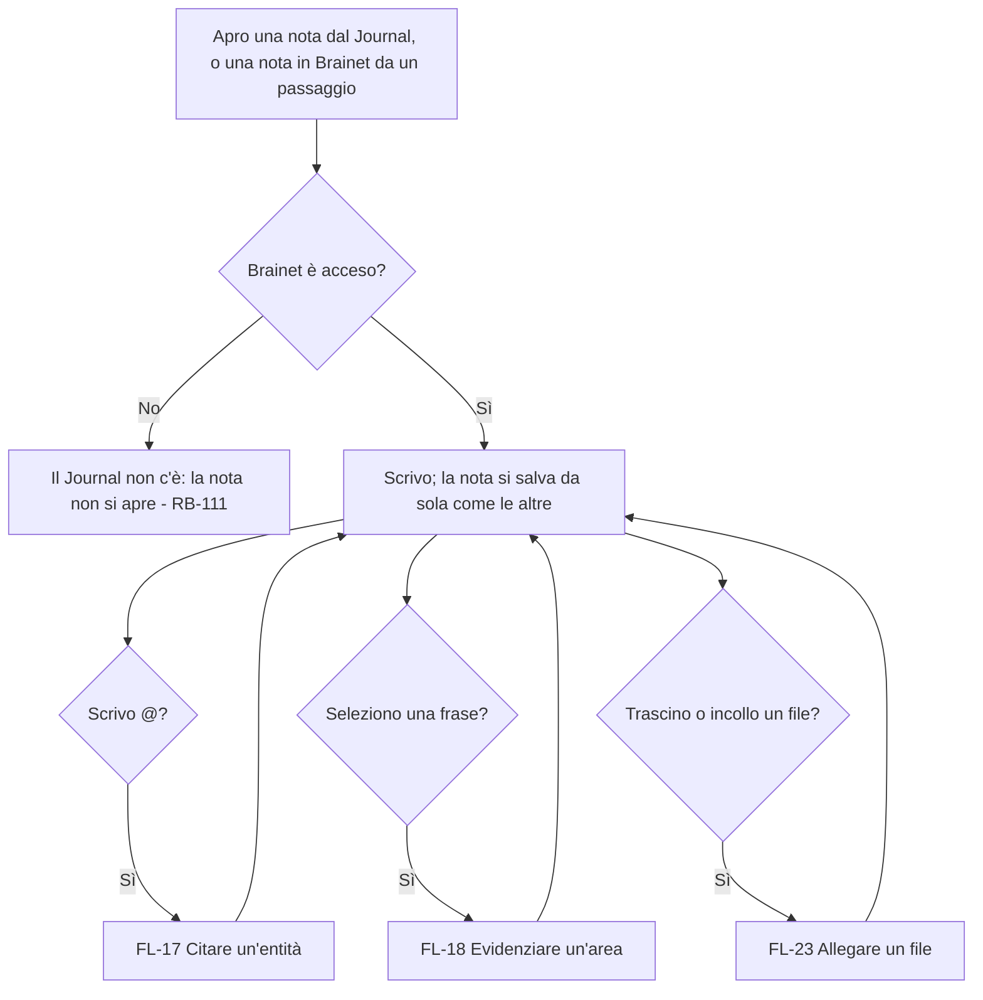

### Percorsi alternativi
- **In una nota di CLOUD:** `@` è un carattere e la selezione non apre menu; gli allegati sì (RB-123, DEC-147).
- **Senza rete:** si scrive come sempre; la nota parte quando la rete torna (RF-10).

### Sfighe gestite
| Sfiga | Rilevamento | Comunicazione | Via d'uscita |
|---|---|---|---|
| SF-22 Modifica simultanea | La stessa nota modificata su due computer | Come le note (RB-39) | Una copia in conflitto, con le sue pillole e aree (DEC-06); la copia resta in Brainet |
| SF-06 Input strani | Un segno di Brainet scritto a mano o incollato da fuori (`<cita …>`) | Nessuna | Resta testo normale, non diventa un segno vero |
| SF-05 Cambio idea | Cancello una frase con una pillola o un'area | Nessuna | Ctrl + Z la rimette, con la pillola o l'area |

### Sfighe considerate e scartate
- SF-17 Troppo: vale il limite delle note (DEC-106).

---

## FL-17 – Citare un'entità
**Requisito:** RF-18 · **Attori:** Utente, Sistema

```mermaid
flowchart TD
    A[Scrivo @ e qualche lettera] --> B[Menu dei suggerimenti sotto il cursore, con le sezioni per tipo e il titolo sopra; il primo è evidenziato - RB-104]
    B --> C{Cosa faccio?}
    C -- Frecce e Invio, o un clic --> D[@ e le lettere diventano la pillola dell'entità - RB-104]
    C -- Crea «…» --> E[Nasce l'entità, senza tipo, e la sua pillola; la scrittura non si interrompe - RB-105]
    C -- Esc --> F[Il menu si chiude; resta il testo scritto, senza pillola]
    D --> G[Continuo a scrivere]
    E --> G
    G --> H{Backspace subito dopo la pillola?}
    H -- Sì --> I[La pillola si toglie tutta, come in Gmail - RB-104]
```

### Percorsi alternativi
- **Nessun suggerimento:** nel menu resta solo «Crea «…»».
- **Pillola in un'area:** l'area prende da sola anche l'entità citata (RB-107).

### Sfighe gestite
| Sfiga | Rilevamento | Comunicazione | Via d'uscita |
|---|---|---|---|
| SF-19 Duplicati | La stessa persona creata due volte con nomi diversi | Nessuna | FL-19 Unire due entità |
| SF-06 Input strani | Nomi con accenti, apostrofi, spazi | Nessuna | Il filtro ignora maiuscole e accenti (proposta dell'agente) |
| SF-20 Riferimenti spariti | L'entità della pillola è stata unita a un'altra | Nessuna | La pillola mostra l'entità che resta (RB-108) |

### Sfighe considerate e scartate
- SF-01 Doppio invio: Invio due volte crea una pillola sola, poi va a capo.
- Le altre sfighe non riguardano le citazioni.

---

## FL-18 – Evidenziare un'area
**Requisito:** RF-18 · **Attori:** Utente, Sistema

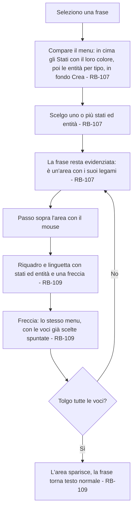

### Percorsi alternativi
- **Un'area con una pillola dentro:** prende da sola anche l'entità citata (RB-107).
- **Aree sovrapposte:** due aree diverse sulla stessa frase restano tutte e due (proposta dell'agente). Riselezionando esattamente la frase di un'area si riapre il suo menu, invece di crearne un'altra uguale sopra (prove a mano del 16/10/2026, RB-129).
- **Testo dell'area cancellato:** un'area rimasta senza testo, o a metà perché il testo cancellato si è portato via la sua apertura o la sua chiusura, sparisce (RB-129).

### Sfighe gestite
| Sfiga | Rilevamento | Comunicazione | Via d'uscita |
|---|---|---|---|
| SF-05 Cambio idea | Uno stato o un'entità scelti per errore | Linguetta | Freccia e la tolgo (RB-109) |
| SF-20 Riferimenti spariti | Lo stato è stato tolto dalle Impostazioni | Nessuna | Sparisce dall'area; l'area resta se ha altri legami (RB-110) |
| SF-22 Modifica simultanea | La frase cambiata su un altro computer | Come le note | L'area segue il testo; se la frase sparisce, sparisce anche l'area (proposta dell'agente) |

### Sfighe considerate e scartate
- Le altre sfighe non riguardano le aree.

---

## FL-19 – Unire due entità
**Requisito:** RF-18 · **Attori:** Utente, Sistema

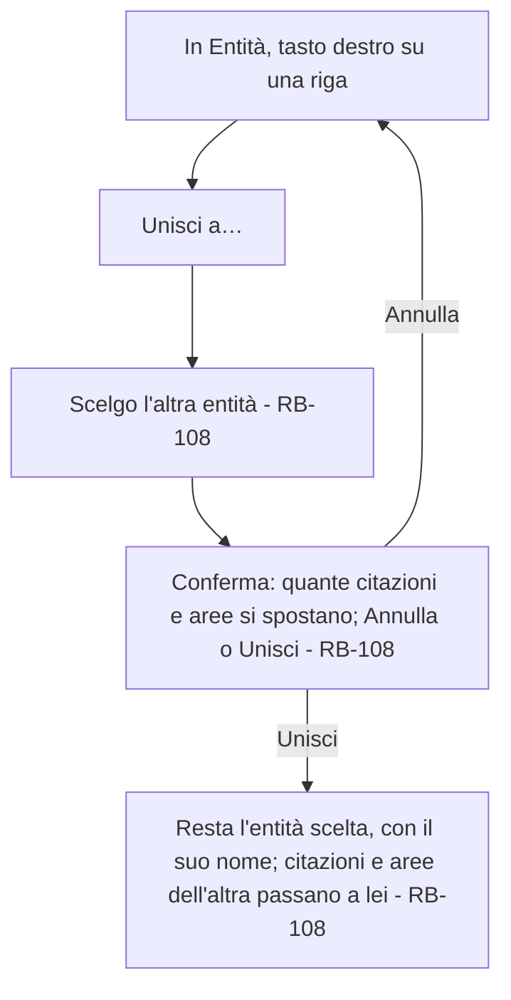

### Sfighe gestite
| Sfiga | Rilevamento | Comunicazione | Via d'uscita |
|---|---|---|---|
| SF-05 Cambio idea | Unione sbagliata | La finestra di conferma, con quante citazioni e aree si spostano | «Annulla» prima di unire; dopo non si torna indietro (RB-108) |
| SF-22 Modifica simultanea | La stessa entità usata su un altro computer mentre si unisce | Nessuna | Le citazioni nuove arrivate dopo passano anch'esse all'entità che resta (RB-108) |

---

## FL-20 – Accendere e spegnere Brainet
**Requisito:** RF-18 · **Attori:** Utente, Sistema

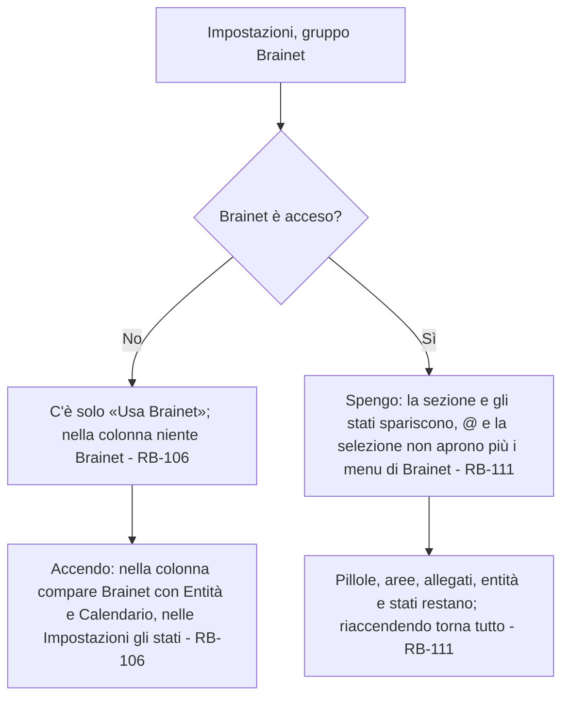

### Sfighe gestite
| Sfiga | Rilevamento | Comunicazione | Via d'uscita |
|---|---|---|---|
| SF-05 Cambio idea | Interruttore spento per sbaglio | Nessuna | Lo riaccendo: non si è perso niente (RB-111) |
| SF-24 Modifiche «da sopra» | Brainet spento da un altro computer mentre scrivo | Nessuna | La sezione sparisce e i menu di Brainet si chiudono; il testo resta (RB-111) |
| SF-08 Rete che cade | Spento senza rete | Nessuna | Vale subito qui; sugli altri computer al primo contatto |

---

## FL-21 – Creare e togliere gli stati
**Requisito:** RF-18 · **Attori:** Utente, Sistema

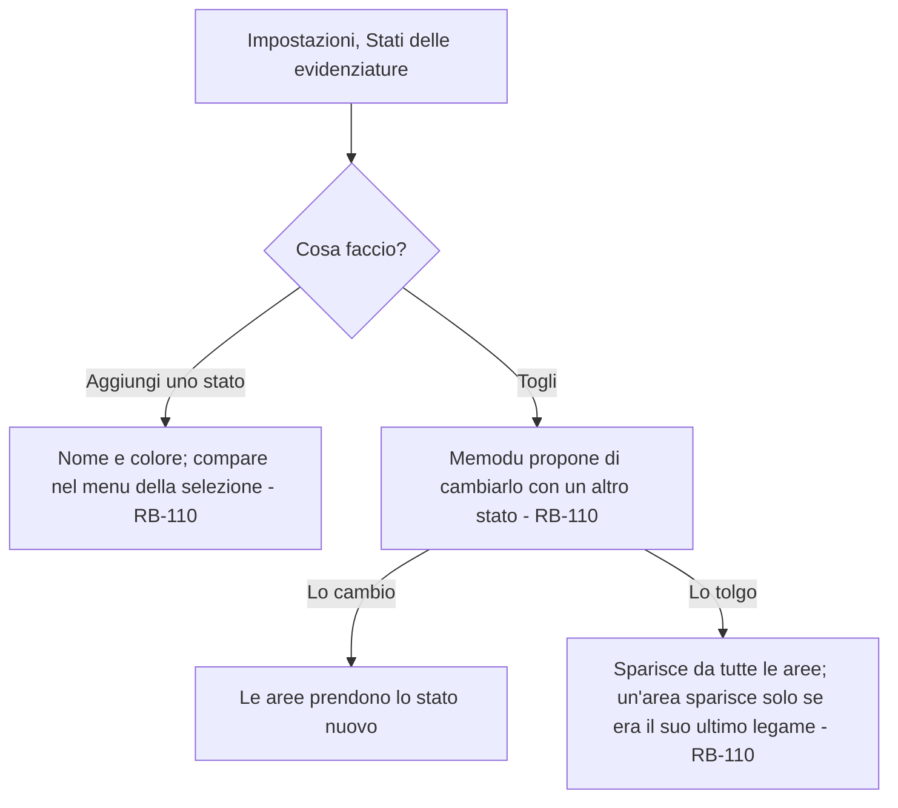

---

## FL-22 – Importare una nota in Brainet
Tolto il 16/10/2026 (DEC-145): non ci sono più note Brainet in cui importare.

---

<!-- FL-23 … FL-25 e RB-114 … RB-121 scritti dall'agente il 15/10/2026 e approvati da Manuel Cucca lo stesso giorno, con le proposte dell'agente. -->

## FL-23 – Allegare un file
**Requisito:** RF-18 (allegati) · **Attori:** Utente, Sistema

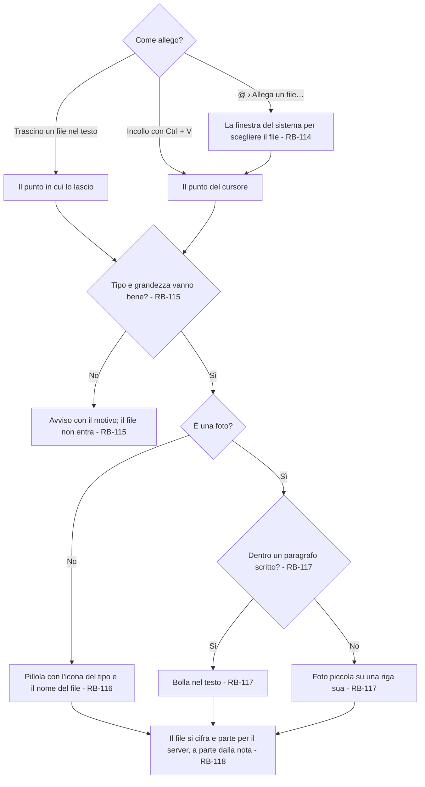

### Percorsi alternativi
- **Più file insieme:** trascinati o incollati insieme, entrano uno dopo l'altro nello stesso punto; quelli che non vanno bene restano fuori con un avviso solo (proposta dell'agente).
- **Senza rete:** l'allegato entra lo stesso e parte quando la rete torna (RF-10).

### Sfighe gestite
| Sfiga | Rilevamento | Comunicazione | Via d'uscita |
|---|---|---|---|
| SF-17 Troppo | Il file supera 25 MB | Avviso «Il file supera 25 MB: non si può allegare.» | Il file resta fuori (RB-115) |
| SF-21 File problematici | Tipo non ammesso, o un'immagine che non si apre | Avviso «Si allegano solo foto e documenti (JPG, PNG, PDF, Word, Excel, PowerPoint, testo).» | Il file resta fuori (RB-115) |
| SF-01 Doppio invio | Lo stesso file trascinato due volte | Nessuna | Due allegati; se ne toglie uno |
| SF-08 Connessione che cade a metà | Il file non finisce di partire | Nessuna | Riparte al giro dopo della sincronizzazione (RB-118) |
| SF-37 Il disco rifiuta l'operazione | Il file non si legge | Avviso «Non riesco a leggere il file.» | Il file resta fuori |

### Sfighe considerate e scartate
- SF-34, SF-36: il file è cifrato e il server non lo apre mai.

---

## FL-24 – Usare un allegato
**Requisito:** RF-18 (allegati) · **Attori:** Utente, Sistema

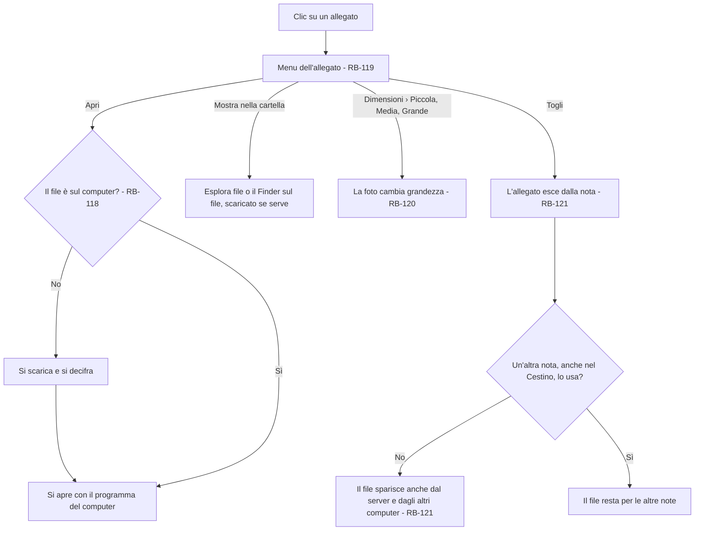

### Percorsi alternativi
- **Dimensioni:** c'è solo per le foto fuori dal paragrafo; la grandezza attuale ha la spunta (RB-120).
- **Annulla:** Ctrl + Z dopo «Togli» rimette l'allegato, finché il file c'è ancora (proposta dell'agente).

### Sfighe gestite
| Sfiga | Rilevamento | Comunicazione | Via d'uscita |
|---|---|---|---|
| SF-08 Connessione che cade a metà | Il file non si scarica | Avviso «Non riesco a scaricare l'allegato. Riprova quando c'è la rete.» | Si riprova con «Apri» |
| SF-20 Riferimenti spariti | Il file è stato tolto da un altro computer | La pillola o la foto mostra «Allegato non più disponibile» | «Togli» |
| SF-22 Modifica simultanea | La stessa nota cambiata su due computer | Come le note | Una copia in conflitto con i suoi allegati (DEC-06) |
| SF-40 Controlli del sistema | Il programma del computer non apre il file, o il sistema lo blocca | Avviso del sistema | «Mostra nella cartella» |

---

## FL-25 – Mostrare una foto
**Requisito:** RF-18 (allegati) · **Attori:** Sistema

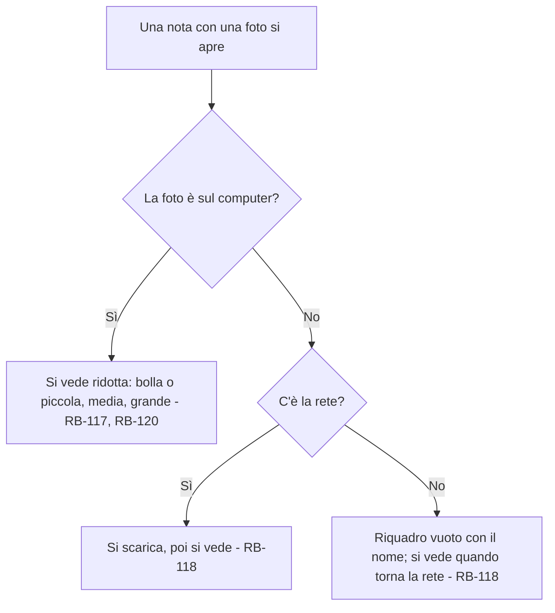

---

## FL-26 – Leggere la pagina di un'entità
**Requisito:** RF-18 · **Attori:** Utente, Sistema

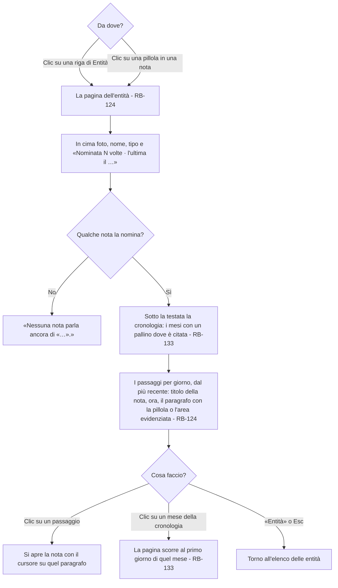

### Percorsi alternativi
- **Entità unita a un'altra:** la pagina mostra quella che resta, con tutti i passaggi (RB-108).
- **Più pillole nello stesso paragrafo:** un passaggio solo (RB-124).
- **Brainet spento mentre la pagina è aperta:** la pagina si chiude e torna il foglio vuoto (proposta dell'agente).

### Sfighe gestite
| Sfiga | Rilevamento | Comunicazione | Via d'uscita |
|---|---|---|---|
| SF-16 Vuoto | Nessuna nota nomina l'entità | «Nessuna nota parla ancora di «…».» | «Entità» per tornare |
| SF-17 Troppo | Centinaia di passaggi | Nessuna | La pagina li mostra tutti e scorre (in sviluppo il caricamento a pezzi, proposto, non è servito: si rivede se la pagina diventa lenta) |
| SF-20 Riferimenti spariti | La nota del passaggio è stata messa nel Cestino | Nessuna | Il passaggio sparisce dalla pagina (RB-127) |
| SF-24 Modifiche «da sopra» | Una nota cambia su un altro computer mentre la pagina è aperta | Nessuna | La pagina si aggiorna da sola |

---

## FL-27 – Il passaggio dalla 1.0.0
**Requisito:** RF-18 · **Attori:** Sistema

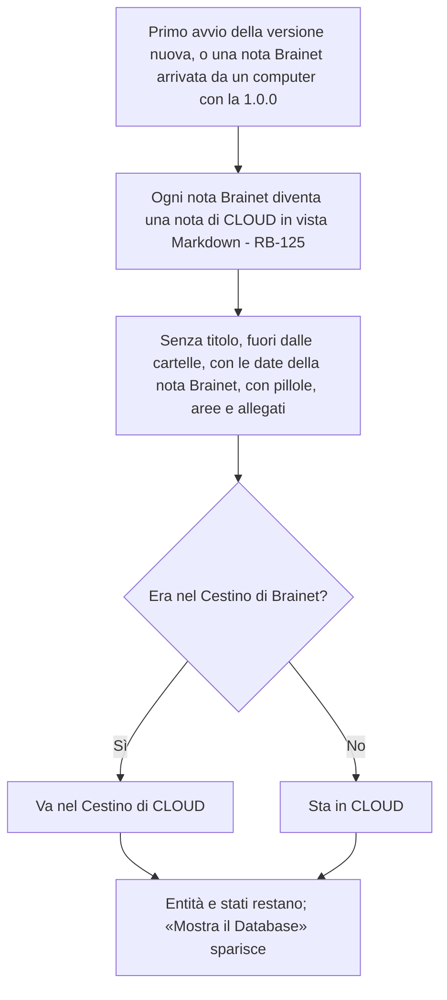

### Sfighe gestite
| Sfiga | Rilevamento | Comunicazione | Via d'uscita |
|---|---|---|---|
| SF-22 Modifica simultanea | Due computer fanno il passaggio della stessa nota | Nessuna | La nota di CLOUD nasce con un identificativo ricavato da quello della nota Brainet: una sola nota (proposta dell'agente) |
| SF-08 Rete che cade | Passaggio senza rete | Nessuna | Avviene sul computer; le note partono quando la rete torna |
| SF-33 Versioni diverse | Un computer è ancora alla 1.0.0 | Nessuna | Le sue note Brainet nuove passano in CLOUD appena arrivano; le note di CLOUD con i segni le vede come testo (rischio accettato da Manuel Cucca il 16/10/2026) |

---

## FL-28 – Spostare una nota in Brainet
**Requisito:** RF-18 · **Attori:** Utente, Sistema

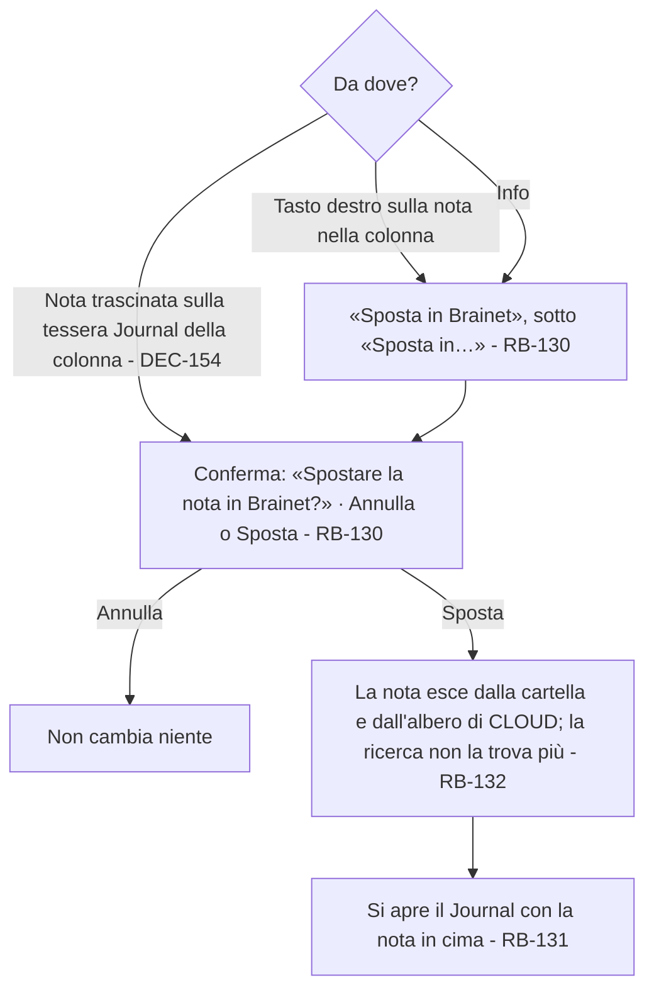

### Percorsi alternativi
- **Brainet spento:** la voce non c'è, e non c'è la tessera Journal su cui trascinare (RB-130).
- **Trascinata sulla tessera Journal:** mentre la nota passa sopra, la tessera si accende e compare «Rilascia: va in Brainet»; lasciata, chiede la stessa conferma (DEC-154, scelta di Manuel Cucca del 19/10/2026). Con Esc o lasciata altrove non cambia niente.
- **Una nota già in Brainet:** non si riporta in CLOUD (RB-130).
- **Eliminata dal Journal:** va nel Cestino; ripristinata torna nel Journal (RB-131).

### Sfighe gestite
| Sfiga | Rilevamento | Comunicazione | Via d'uscita |
|---|---|---|---|
| SF-05 Cambio idea | «Sposta» senza volerlo | La conferma dice che non si torna indietro | «Annulla» |
| SF-01 Doppio invio | Doppio clic su «Sposta» | Nessuna | Uno spostamento solo |
| SF-22 Modifica simultanea | La nota cambiata su un altro computer mentre la si sposta | Come le note | Lo spostamento e il testo si fondono campo per campo (DEC-76) |
| SF-08 Rete che cade | Spostata senza rete | Nessuna | Vale subito qui; sugli altri computer al primo contatto |

---

## Punti da decidere nei flussi
- ~~Cosa fa un clic su un giorno del Calendario.~~ Niente: il Calendario si guarda soltanto (scelta di Manuel Cucca del 14/10/2026, RB-113).
- ~~Come si annulla un'unione sbagliata (FL-19).~~ Prima di unire una finestra chiede conferma, con quante citazioni e aree si spostano; poi non si annulla (scelta di Manuel Cucca del 14/10/2026, RB-108).
- ~~Cosa vede chi sta scrivendo quando Brainet viene cancellato da un altro computer (FL-20).~~ La sezione sparisce, il foglio si chiude e un avviso dice «Brainet è stato spento da un altro computer»; il testo che si stava scrivendo si perde (scelta di Manuel Cucca del 14/10/2026, RB-111).
- ~~Se Brainet, spento su un computer, resta acceso sugli altri.~~ No: spegnere cancella tutto, quindi vale per tutti i computer (RB-111).

## Regole di business
| Codice | Regola | Usata in |
|---|---|---|
| RB-101 | Tolta il 16/10/2026 (DEC-145): il + accanto a Brainet non c'è più | — |
| RB-102 | Tolta il 16/10/2026 (DEC-145): si scrive nelle note di CLOUD, che si salvano come sempre | — |
| RB-103 | Tolta il 16/10/2026 (DEC-145): il Database non c'è più | — |
| RB-104 | Con @ si apre il menu dei suggerimenti, diviso per tipo con il titolo sopra; frecce e Invio o un clic scelgono; Esc chiude; Backspace subito dopo una pillola la toglie tutta | FL-17 |
| RB-105 | «Crea «…»» fa nascere l'entità senza tipo, senza interrompere la scrittura; il tipo si assegna più avanti | FL-17 |
| RB-106 | «Usa Brainet» spento: niente Brainet né nella colonna né nelle Impostazioni, a parte l'interruttore; acceso, nella colonna Entità e Calendario e nelle Impostazioni gli stati («Mostra il Database» tolto il 16/10/2026, DEC-145) | FL-20 |
| RB-107 | Un'area è una frase evidenziata legata a uno o più stati ed entità, scelti dal menu della selezione; un'area che contiene una pillola prende anche l'entità citata | FL-17, FL-18 |
| RB-108 | «Unisci a…» in Entità: una finestra chiede conferma e dice quante citazioni e aree si spostano; unite, resta l'entità scelta con il suo nome e citazioni e aree dell'altra passano a lei; l'unione non si annulla | FL-19 |
| RB-109 | Passando sopra un'area compaiono il riquadro e la linguetta con i suoi legami; la freccia apre il menu con le voci spuntate; tolte tutte, l'area sparisce | FL-18 |
| RB-110 | Gli stati sono un elenco breve nelle Impostazioni, ognuno con un colore; togliendone uno Memodu propone di cambiarlo, e tolto sparisce dalle aree, che spariscono solo se era il loro ultimo legame | FL-18, FL-21 |
| RB-111 | Spegnere Brainet non cancella niente e non chiede conferma: spariscono la sezione e i menu di @ e della selezione; pillole, aree, allegati, entità e stati restano e si vedono; vale per tutti i computer (DEC-145, 16/10/2026; prima spegnere cancellava tutto) | FL-16, FL-20 |
| RB-112 | Tolta il 16/10/2026 (DEC-145): «Importa in Brainet» non c'è più | — |
| RB-113 | Il Calendario ha un pallino solo per ogni giorno in cui è nata almeno una nota di CLOUD, fuori dal Cestino, con una pillola o un'area (DEC-145, scelta di Manuel Cucca del 16/10/2026); si guarda soltanto: un clic su un giorno non fa niente | FL-16 |
| RB-114 | Si allega trascinando un file nel testo, incollandolo o con @ › «Allega un file…», in fondo al menu dopo «Crea». Trascinato sopra il testo di una nota in vista Markdown, il file si allega nel punto in cui si lascia e il velo di Locale non compare; altrove va in Locale come prima (DEC-120; scelta di Manuel Cucca del 15/10/2026) | FL-23 |
| RB-115 | Si allegano solo foto e documenti comuni (JPG, PNG, PDF, Word, Excel, PowerPoint, testo) fino a 25 MB; un file diverso non entra e un avviso dice perché | FL-23 |
| RB-116 | Un documento è una pillola come quella di una persona, con l'icona e il nome del file; l'icona è la stessa per tutti i documenti (scelta di Manuel Cucca del 15/10/2026) | FL-23 |
| RB-117 | Una foto dentro un paragrafo scritto è una bolla; fuori, su una riga sua, arriva piccola | FL-23, FL-25 |
| RB-118 | Gli allegati viaggiano a parte dalle note, cifrati; sul computer si scaricano la prima volta che servono; senza rete una foto non scaricata è un riquadro vuoto con il nome | FL-23, FL-24, FL-25 |
| RB-119 | Un clic su un allegato apre il menu: «Apri» (con il programma del computer), «Mostra nella cartella», «Togli»; per le foto fuori dal paragrafo anche «Dimensioni» | FL-24 |
| RB-120 | «Dimensioni» apre Piccola, Media e Grande, con la spunta su quella attuale; nella nota le foto si vedono ridotte, «Apri» apre il file vero | FL-24, FL-25 |
| RB-121 | «Togli» toglie l'allegato dalla nota; il file sparisce dal server e dagli altri computer quando nessuna nota lo usa più, anche nel Cestino | FL-24 |
| RB-122 | Il tipo di un'entità si cambia in Entità con un clic sulla sua pillola del tipo: Persona, Argomento, Evento, Oggetto o «Senza tipo», spuntato quello attuale; il cambio si sincronizza come il resto | SC-11 |
| RB-123 | Brainet vive nelle note di CLOUD in vista Markdown; in vista Testo @ è un carattere e la selezione non apre menu. Una nota con pillole, aree o allegati non passa a Testo: in Info la scelta è spenta con la riga «Questa nota usa Brainet: si vede solo in Markdown» (DEC-145) | FL-16 |
| RB-124 | La pagina dell'entità mostra i paragrafi delle note che la citano o la legano con un'area (il testo tra due righe vuote; un titolo o una voce di elenco è una riga sola, DEC-146), uno per paragrafo, raggruppati per giorno di creazione della nota dal più recente, con il titolo della nota e l'ora; un clic apre la nota sul paragrafo (proposta dell'agente, DEC-145) | FL-26 |
| RB-125 | Al passaggio dalla 1.0.0 ogni nota Brainet diventa una nota di CLOUD in vista Markdown, senza titolo, fuori dalle cartelle, con le sue date e i suoi segni; quelle nel Cestino vanno nel Cestino; lo stesso per le note Brainet che arrivano da un computer con la 1.0.0 (DEC-145) | FL-27 |
| RB-126 | La ricerca legge il testo delle note senza i segni di Brainet: trova il nome della pillola e la frase dell'area, non i codici (DEC-145) | FL-16 |
| RB-127 | Entità, pagina dell'entità e Calendario contano solo le note di CLOUD fuori dal Cestino (proposta dell'agente, DEC-145) | FL-16, FL-26 |
| RB-128 | Esportando, la pillola diventa `[[nome]]`, l'area `==frase==` senza gli stati, la foto `` e il documento `[nome](allegati/nome)` (DEC-145, RF-13) | — |
| RB-129 | Un'area senza testo o rimasta a metà (cancellata l'apertura o la chiusura) sparisce nella stessa modifica; riselezionando la frase di un'area si apre il suo menu, non nasce un'area uguale (prove a mano del 16/10/2026, correzione dell'agente) | FL-18 |
| RB-130 | «Sposta in Brainet» (tasto destro sulla nota nella colonna, sotto «Sposta in…», Info, o la nota trascinata sulla tessera Journal della colonna, DEC-154), solo con Brainet acceso, dopo una conferma: «Spostare la nota in Brainet?» · «La nota esce da CLOUD e dalla ricerca e non si riporta indietro. Nel Journal puoi collegarla a persone, oggetti e argomenti.» · «Annulla», «Sposta». Senza ritorno (DEC-147) | FL-28 |
| RB-131 | Il Journal elenca le note in Brainet fuori dal Cestino, dalla più recente, con il giorno e l'ora sopra ognuna (con la data scelta in Info, quel giorno senza ora, come nella pagina dell'entità e nell'ordine); si modificano lì; tasto destro › «Elimina» le manda nel Cestino, ripristinate tornano nel Journal (DEC-147) | FL-28 |
| RB-132 | Una nota in Brainet non sta nell'albero di CLOUD né in nessuna cartella (DEC-147) | FL-28 |
| RB-133 | La pagina dell'entità ha, sotto la testata, la cronologia: i mesi dal primo all'ultimo in cui è citata, dal più vecchio a sinistra; un pallino nei mesi con paragrafi, più grande se sono di più (1, da 2 a 4, 5 o più); un clic su un mese porta al suo giorno più recente nell'elenco; se i mesi non ci stanno la striscia scorre di lato e parte dal più recente (DEC-150) | FL-26 |
