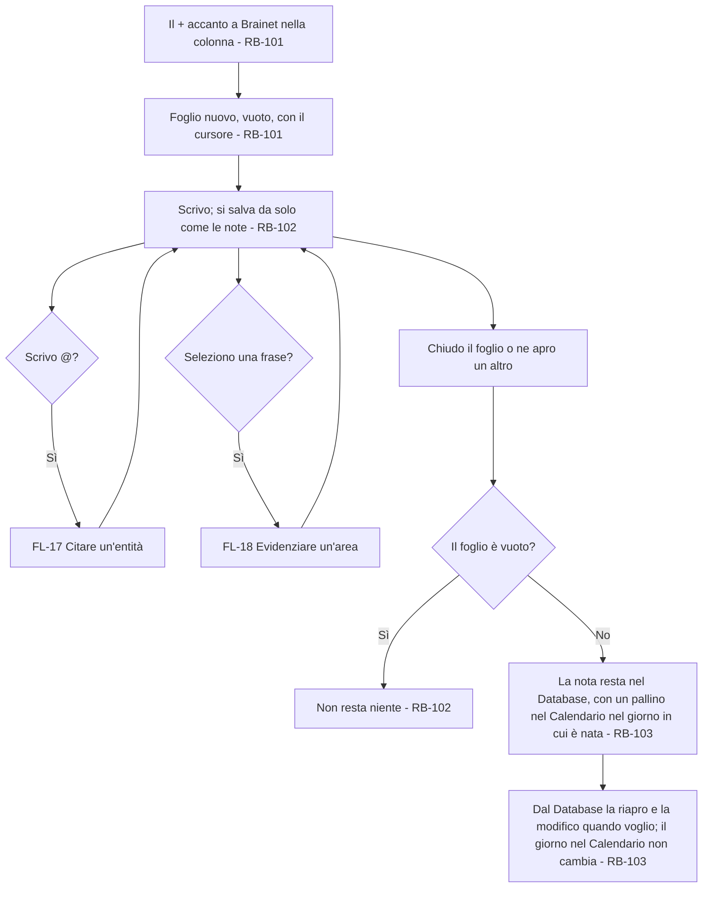
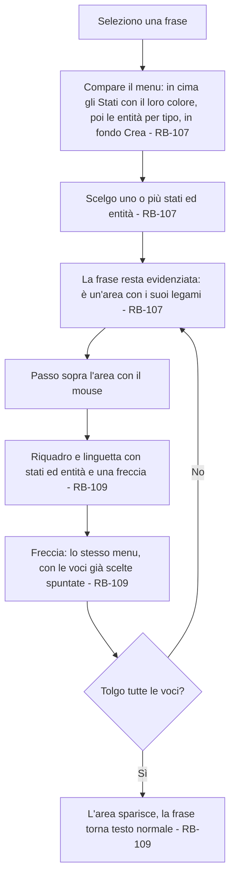
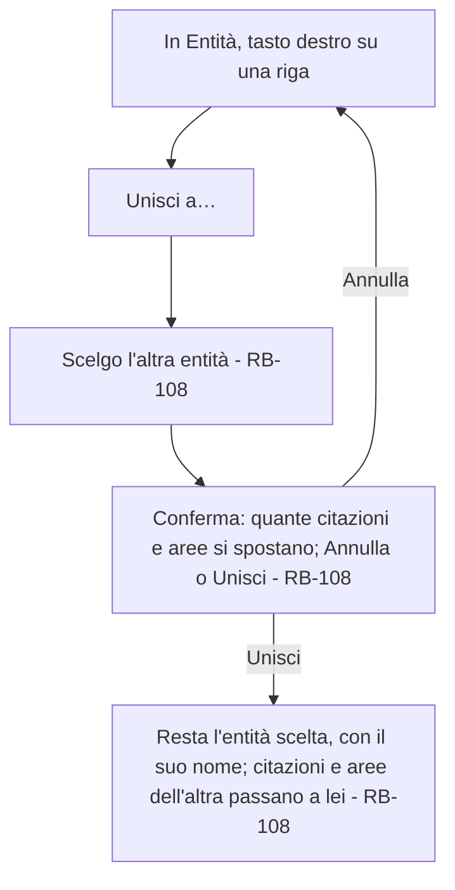
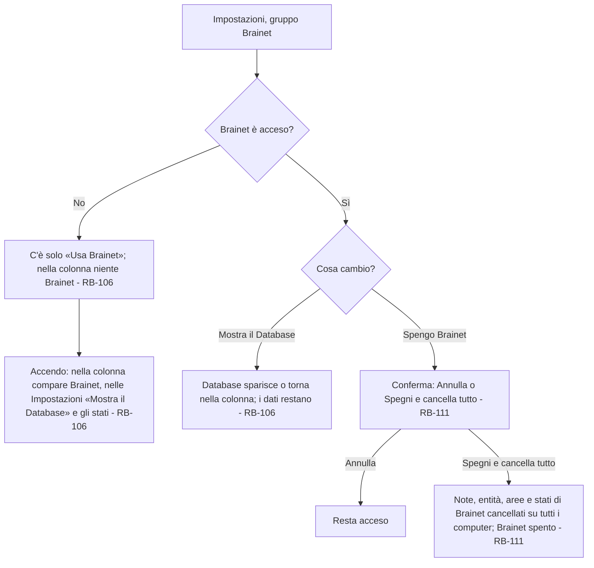
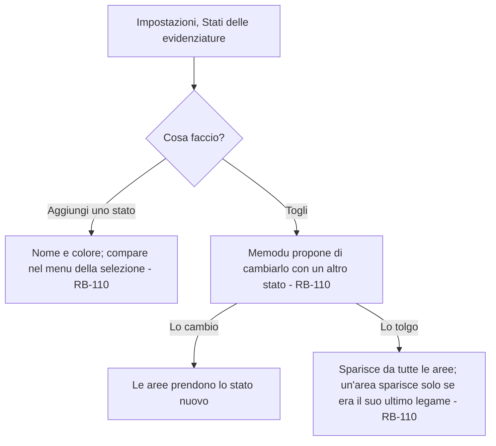
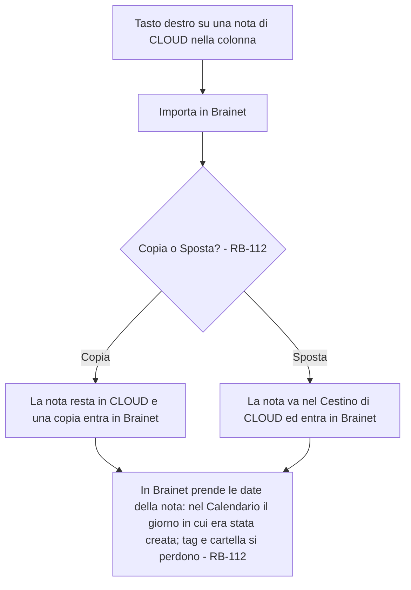
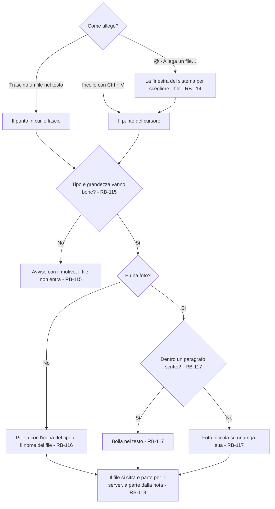
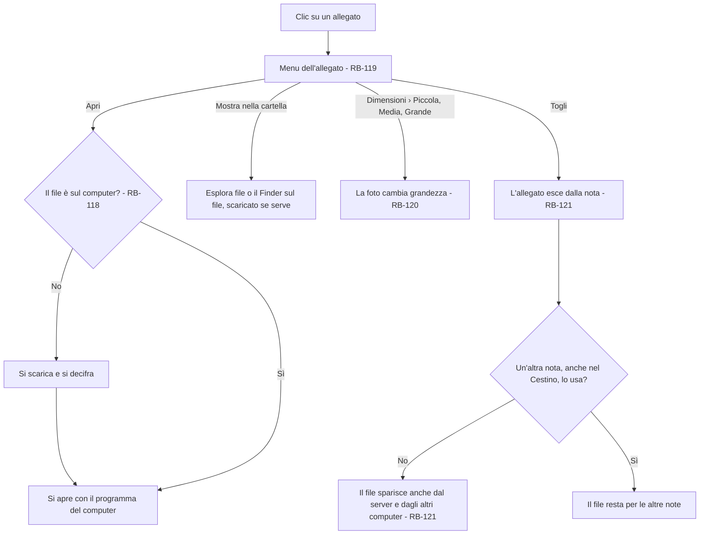
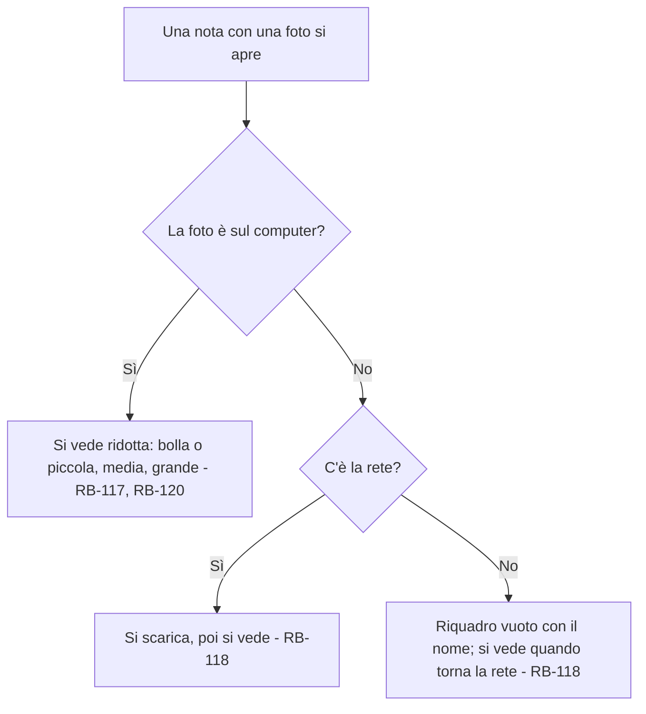

# Brainet – Flussi

<!-- Fase 2 della guida. I diagrammi si scrivono in Mermaid. Scritti dall'agente il 14/10/2026 dalle scelte di Manuel Cucca in `1-requisiti.md`; approvati da Manuel Cucca il 14/10/2026, con le proposte dell'agente. -->

## FL-16 – Scrivere una nota Brainet
**Requisito:** RF-18 · **Attori:** Utente, Sistema



### Percorsi alternativi
- **Senza rete:** si scrive come sempre; la nota parte quando la rete torna (RF-10).
- **Database nascosto:** la nota si scrive lo stesso; per rileggerla si riaccende «Mostra il Database» (RB-106).

### Sfighe gestite
| Sfiga | Rilevamento | Comunicazione | Via d'uscita |
|---|---|---|---|
| SF-02 Abbandono a metà | Il foglio si chiude con del testo | Nessuna | Il testo è già salvato (RB-102) |
| SF-16 Vuoto | Il foglio si chiude senza testo | Nessuna | Non nasce niente (RB-102) |
| SF-22 Modifica simultanea | La stessa nota modificata su due computer | Come le note (RB-39) | Una copia in conflitto, come in CLOUD (DEC-06) |

### Sfighe considerate e scartate
- SF-17 Troppo: vale il limite delle note (DEC-106).
- Le altre sfighe non riguardano la scrittura.

---

## FL-17 – Citare un'entità
**Requisito:** RF-18 · **Attori:** Utente, Sistema

```mermaid
flowchart TD
    A[Scrivo @ e qualche lettera] --> B[Menu dei suggerimenti sotto il cursore, con le sezioni per tipo e il titolo sopra; il primo è evidenziato - RB-104]
    B --> C{Cosa faccio?}
    C -- Frecce e Invio, o un clic --> D[@ e le lettere diventano la pillola dell'entità - RB-104]
    C -- Crea «…» --> E[Nasce l'entità, senza tipo, e la sua pillola; la scrittura non si interrompe - RB-105]
    C -- Esc --> F[Il menu si chiude; resta il testo scritto, senza pillola]
    D --> G[Continuo a scrivere]
    E --> G
    G --> H{Backspace subito dopo la pillola?}
    H -- Sì --> I[La pillola si toglie tutta, come in Gmail - RB-104]
```

### Percorsi alternativi
- **Nessun suggerimento:** nel menu resta solo «Crea «…»».
- **Pillola in un'area:** l'area prende da sola anche l'entità citata (RB-107).

### Sfighe gestite
| Sfiga | Rilevamento | Comunicazione | Via d'uscita |
|---|---|---|---|
| SF-19 Duplicati | La stessa persona creata due volte con nomi diversi | Nessuna | FL-19 Unire due entità |
| SF-06 Input strani | Nomi con accenti, apostrofi, spazi | Nessuna | Il filtro ignora maiuscole e accenti (proposta dell'agente) |
| SF-20 Riferimenti spariti | L'entità della pillola è stata unita a un'altra | Nessuna | La pillola mostra l'entità che resta (RB-108) |

### Sfighe considerate e scartate
- SF-01 Doppio invio: Invio due volte crea una pillola sola, poi va a capo.
- Le altre sfighe non riguardano le citazioni.

---

## FL-18 – Evidenziare un'area
**Requisito:** RF-18 · **Attori:** Utente, Sistema



### Percorsi alternativi
- **Un'area con una pillola dentro:** prende da sola anche l'entità citata (RB-107).
- **Aree sovrapposte:** due aree diverse sulla stessa frase restano tutte e due (proposta dell'agente).

### Sfighe gestite
| Sfiga | Rilevamento | Comunicazione | Via d'uscita |
|---|---|---|---|
| SF-05 Cambio idea | Uno stato o un'entità scelti per errore | Linguetta | Freccia e la tolgo (RB-109) |
| SF-20 Riferimenti spariti | Lo stato è stato tolto dalle Impostazioni | Nessuna | Sparisce dall'area; l'area resta se ha altri legami (RB-110) |
| SF-22 Modifica simultanea | La frase cambiata su un altro computer | Come le note | L'area segue il testo; se la frase sparisce, sparisce anche l'area (proposta dell'agente) |

### Sfighe considerate e scartate
- Le altre sfighe non riguardano le aree.

---

## FL-19 – Unire due entità
**Requisito:** RF-18 · **Attori:** Utente, Sistema



### Sfighe gestite
| Sfiga | Rilevamento | Comunicazione | Via d'uscita |
|---|---|---|---|
| SF-05 Cambio idea | Unione sbagliata | La finestra di conferma, con quante citazioni e aree si spostano | «Annulla» prima di unire; dopo non si torna indietro (RB-108) |
| SF-22 Modifica simultanea | La stessa entità usata su un altro computer mentre si unisce | Nessuna | Le citazioni nuove arrivate dopo passano anch'esse all'entità che resta (RB-108) |

---

## FL-20 – Accendere e spegnere Brainet e il Database
**Requisito:** RF-18 · **Attori:** Utente, Sistema



### Sfighe gestite
| Sfiga | Rilevamento | Comunicazione | Via d'uscita |
|---|---|---|---|
| SF-01 Doppio invio | Doppio clic su «Spegni e cancella tutto» | Nessuna | Una cancellazione sola |
| SF-05 Cambio idea | Interruttore spento per sbaglio | La finestra di conferma | «Annulla» (RB-111) |
| SF-08 Rete che cade | La cancellazione parte senza rete | Nessuna | Parte quando la rete torna; sugli altri computer Brainet si cancella al primo contatto |
| SF-24 Modifiche «da sopra» | Brainet cancellato da un altro computer mentre scrivo | Avviso «Brainet è stato spento da un altro computer» | La sezione sparisce e il foglio si chiude; il testo che si stava scrivendo si perde (RB-111) |

---

## FL-21 – Creare e togliere gli stati
**Requisito:** RF-18 · **Attori:** Utente, Sistema



---

## FL-22 – Importare una nota in Brainet
**Requisito:** RF-18 · **Attori:** Utente, Sistema



### Sfighe gestite
| Sfiga | Rilevamento | Comunicazione | Via d'uscita |
|---|---|---|---|
| SF-01 Doppio invio | La stessa nota copiata due volte | Nessuna | Due frammenti uguali; si toglie uno dal Database |
| SF-21 File problematici | Una nota di CLOUD con immagini (rinviate dopo la v1) | Nessuna | Le note di CLOUD non hanno allegati: in Brainet non ne arrivano (15/10/2026) |

---

<!-- FL-23 … FL-25 e RB-114 … RB-121 scritti dall'agente il 15/10/2026 e approvati da Manuel Cucca lo stesso giorno, con le proposte dell'agente. -->

## FL-23 – Allegare un file
**Requisito:** RF-18 (allegati) · **Attori:** Utente, Sistema



### Percorsi alternativi
- **Più file insieme:** trascinati o incollati insieme, entrano uno dopo l'altro nello stesso punto; quelli che non vanno bene restano fuori con un avviso solo (proposta dell'agente).
- **Senza rete:** l'allegato entra lo stesso e parte quando la rete torna (RF-10).

### Sfighe gestite
| Sfiga | Rilevamento | Comunicazione | Via d'uscita |
|---|---|---|---|
| SF-17 Troppo | Il file supera 25 MB | Avviso «Il file supera 25 MB: non si può allegare.» | Il file resta fuori (RB-115) |
| SF-21 File problematici | Tipo non ammesso, o un'immagine che non si apre | Avviso «Si allegano solo foto e documenti (JPG, PNG, PDF, Word, Excel, PowerPoint, testo).» | Il file resta fuori (RB-115) |
| SF-01 Doppio invio | Lo stesso file trascinato due volte | Nessuna | Due allegati; se ne toglie uno |
| SF-08 Connessione che cade a metà | Il file non finisce di partire | Nessuna | Riparte al giro dopo della sincronizzazione (RB-118) |
| SF-37 Il disco rifiuta l'operazione | Il file non si legge | Avviso «Non riesco a leggere il file.» | Il file resta fuori |

### Sfighe considerate e scartate
- SF-34, SF-36: il file è cifrato e il server non lo apre mai.

---

## FL-24 – Usare un allegato
**Requisito:** RF-18 (allegati) · **Attori:** Utente, Sistema



### Percorsi alternativi
- **Dimensioni:** c'è solo per le foto fuori dal paragrafo; la grandezza attuale ha la spunta (RB-120).
- **Annulla:** Ctrl + Z dopo «Togli» rimette l'allegato, finché il file c'è ancora (proposta dell'agente).

### Sfighe gestite
| Sfiga | Rilevamento | Comunicazione | Via d'uscita |
|---|---|---|---|
| SF-08 Connessione che cade a metà | Il file non si scarica | Avviso «Non riesco a scaricare l'allegato. Riprova quando c'è la rete.» | Si riprova con «Apri» |
| SF-20 Riferimenti spariti | Il file è stato tolto da un altro computer | La pillola o la foto mostra «Allegato non più disponibile» | «Togli» |
| SF-22 Modifica simultanea | La stessa nota cambiata su due computer | Come le note | Una copia in conflitto con i suoi allegati (DEC-06) |
| SF-40 Controlli del sistema | Il programma del computer non apre il file, o il sistema lo blocca | Avviso del sistema | «Mostra nella cartella» |

---

## FL-25 – Mostrare una foto
**Requisito:** RF-18 (allegati) · **Attori:** Sistema



---

## Punti da decidere nei flussi
- ~~Cosa fa un clic su un giorno del Calendario.~~ Niente: il Calendario si guarda soltanto (scelta di Manuel Cucca del 14/10/2026, RB-113).
- ~~Come si annulla un'unione sbagliata (FL-19).~~ Prima di unire una finestra chiede conferma, con quante citazioni e aree si spostano; poi non si annulla (scelta di Manuel Cucca del 14/10/2026, RB-108).
- ~~Cosa vede chi sta scrivendo quando Brainet viene cancellato da un altro computer (FL-20).~~ La sezione sparisce, il foglio si chiude e un avviso dice «Brainet è stato spento da un altro computer»; il testo che si stava scrivendo si perde (scelta di Manuel Cucca del 14/10/2026, RB-111).
- ~~Se Brainet, spento su un computer, resta acceso sugli altri.~~ No: spegnere cancella tutto, quindi vale per tutti i computer (RB-111).

## Regole di business
| Codice | Regola | Usata in |
|---|---|---|
| RB-101 | Il + accanto al titolo Brainet, come nelle altre sezioni, apre un foglio nuovo che accetta testo | FL-16 |
| RB-102 | La nota Brainet si salva da sola mentre si scrive, come le note; un foglio chiuso vuoto non lascia niente (proposta dell'agente) | FL-16 |
| RB-103 | Una nota Brainet si legge e si modifica solo dal Database; nel Calendario resta il giorno in cui è nata | FL-16 |
| RB-104 | Con @ si apre il menu dei suggerimenti, diviso per tipo con il titolo sopra; frecce e Invio o un clic scelgono; Esc chiude; Backspace subito dopo una pillola la toglie tutta | FL-17 |
| RB-105 | «Crea «…»» fa nascere l'entità senza tipo, senza interrompere la scrittura; il tipo si assegna più avanti | FL-17 |
| RB-106 | «Usa Brainet» spento: niente Brainet né nella colonna né nelle Impostazioni, a parte l'interruttore. «Mostra il Database» spento: la voce Database sparisce dalla colonna, i dati restano | FL-16, FL-20 |
| RB-107 | Un'area è una frase evidenziata legata a uno o più stati ed entità, scelti dal menu della selezione; un'area che contiene una pillola prende anche l'entità citata | FL-17, FL-18 |
| RB-108 | «Unisci a…» in Entità: una finestra chiede conferma e dice quante citazioni e aree si spostano; unite, resta l'entità scelta con il suo nome e citazioni e aree dell'altra passano a lei; l'unione non si annulla | FL-19 |
| RB-109 | Passando sopra un'area compaiono il riquadro e la linguetta con i suoi legami; la freccia apre il menu con le voci spuntate; tolte tutte, l'area sparisce | FL-18 |
| RB-110 | Gli stati sono un elenco breve nelle Impostazioni, ognuno con un colore; togliendone uno Memodu propone di cambiarlo, e tolto sparisce dalle aree, che spariscono solo se era il loro ultimo legame | FL-18, FL-21 |
| RB-111 | Spegnere Brainet vuol dire cancellarlo: conferma con «Annulla» e «Spegni e cancella tutto»; si cancellano note, entità, aree e stati su tutti i computer; su un computer dove si sta scrivendo la sezione sparisce, il foglio si chiude con l'avviso «Brainet è stato spento da un altro computer» e il testo si perde | FL-20 |
| RB-112 | Una nota di CLOUD si importa in Brainet dal menu della colonna, «Importa in Brainet» › Copia o Sposta; con Sposta la nota va nel Cestino di CLOUD (scelta di Manuel Cucca del 15/10/2026); prende le date della nota, tag e cartella si perdono | FL-22 |
| RB-113 | Il Calendario si guarda soltanto: un clic su un giorno non fa niente | — |
| RB-114 | Si allega trascinando un file nel testo, incollandolo o con @ › «Allega un file…», in fondo al menu dopo «Crea». Trascinato sopra il testo di una nota Brainet, il file si allega nel punto in cui si lascia e il velo di Locale non compare; altrove va in Locale come prima (DEC-120; scelta di Manuel Cucca del 15/10/2026) | FL-23 |
| RB-115 | Si allegano solo foto e documenti comuni (JPG, PNG, PDF, Word, Excel, PowerPoint, testo) fino a 25 MB; un file diverso non entra e un avviso dice perché | FL-23 |
| RB-116 | Un documento è una pillola come quella di una persona, con l'icona e il nome del file; l'icona è la stessa per tutti i documenti (scelta di Manuel Cucca del 15/10/2026) | FL-23 |
| RB-117 | Una foto dentro un paragrafo scritto è una bolla; fuori, su una riga sua, arriva piccola | FL-23, FL-25 |
| RB-118 | Gli allegati viaggiano a parte dalle note, cifrati; sul computer si scaricano la prima volta che servono; senza rete una foto non scaricata è un riquadro vuoto con il nome | FL-23, FL-24, FL-25 |
| RB-119 | Un clic su un allegato apre il menu: «Apri» (con il programma del computer), «Mostra nella cartella», «Togli»; per le foto fuori dal paragrafo anche «Dimensioni» | FL-24 |
| RB-120 | «Dimensioni» apre Piccola, Media e Grande, con la spunta su quella attuale; nella nota le foto si vedono ridotte, «Apri» apre il file vero | FL-24, FL-25 |
| RB-121 | «Togli» toglie l'allegato dalla nota; il file sparisce dal server e dagli altri computer quando nessuna nota lo usa più, anche nel Cestino | FL-24 |
