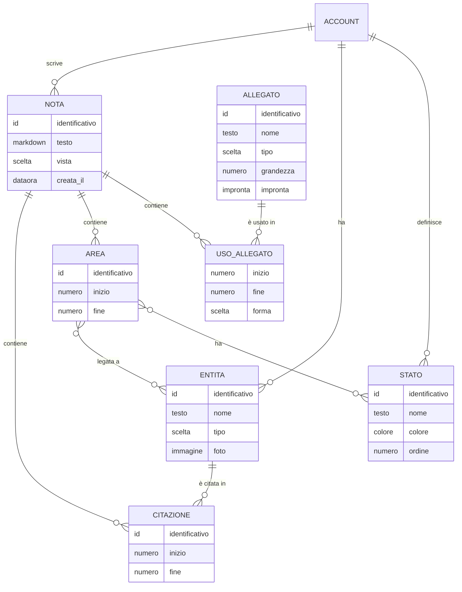

# Brainet – Entità

<!-- Fase 3 della guida. Scritte dall'agente il 14/10/2026 dai flussi FL-16 … FL-22 e dalle regole RB-101 … RB-113; approvate da Manuel Cucca il 14/10/2026, con le proposte dell'agente. Riviste dall'agente il 16/10/2026 per DEC-145: il frammento non c'è più, citazioni, aree e usi degli allegati stanno nelle note di CLOUD (EN-01); approvate da Manuel Cucca il 16/10/2026. «Entità» qui ha due sensi: EN-13 Entità è la persona, l'oggetto, l'evento o l'argomento di cui si parla (la voce Entità della colonna); EN-12 … EN-16 sono le entità del modello dei dati. -->

## Diagramma ER

## EN-12 – Frammento
Tolto il 16/10/2026 (DEC-145): pillole, aree e allegati stanno nel testo delle note di CLOUD (EN-01, nel modulo note), in vista Markdown. I frammenti della 1.0.0 diventano note di CLOUD al passaggio (RB-125): il testo resta com'è, «Nato il» diventa la data di creazione della nota, «Modificato il» quella di modifica, e un frammento nel Cestino va nel Cestino di CLOUD.

- **Nella nota (EN-01):** il testo in Markdown con i segni di Brainet; EN-14, EN-15 ed EN-18 sono l'indice ricavato dal testo, che non si sincronizza (come per i frammenti, scelta di Manuel Cucca del 15/10/2026). La data di creazione della nota è il giorno del Calendario e della pagina dell'entità (RB-113, RB-124).

## EN-13 – Entità
**Descrizione:** una persona, un oggetto, un evento, un argomento, o una cosa ancora senza tipo, citata nelle note o legata alle aree (RB-104, RB-105).

| Attributo | Tipo | Obbligatorio | Vincoli | Note |
|---|---|---|---|---|
| Identificativo | Codice | Sì | Unico e stabile | Tecnico |
| Nome | Testo | Sì | Fino a 200 caratteri (proposta dell'agente) | Il nome della pillola |
| Tipo | Persona \| Oggetto \| Evento \| Argomento \| nessuno | No | | Nasce senza tipo con «Crea» (RB-105); si cambia in Entità (RB-122) |
| Foto | Immagine | No | | La sceglie l'utente dal disco, in Entità, con il tasto destro sulla riga, «Scegli una foto…», per qualsiasi entità; se c'è, la pillola la mostra, altrimenti solo il nome (scelta di Manuel Cucca del 14/10/2026) |
| Unita in | EN-13 | No | | Dopo «Unisci a…» punta all'entità che resta, per le citazioni che arrivano dopo da un altro computer (RB-108) |

- **Chi la crea:** l'utente, con «Crea» nel menu di @ o della selezione.
- **Chi la modifica:** l'utente: unione (RB-108), tipo, foto.
- **Cancellazione:** con l'unione resta solo come rimando (proposta dell'agente). Spegnendo Brainet resta (RB-111, DEC-145).
- **Dati sensibili:** nomi di persone e foto; cifrati end-to-end.

## EN-14 – Citazione
**Descrizione:** una pillola: il punto di una nota in cui un'entità è nominata (RB-104). Non ha un'area.

| Attributo | Tipo | Obbligatorio | Vincoli | Note |
|---|---|---|---|---|
| Nota | EN-01 | Sì | | |
| Entità | EN-13 | Sì | | |
| Posizione | Inizio e fine nel testo | Sì | Dentro il testo della nota | Il segno sta nel testo e si sposta con lui (15/10/2026) |

- **Chi la crea:** l'utente con @; **chi la modifica:** il sistema, quando il testo cambia o le entità si uniscono; **cancellazione:** Backspace subito dopo la pillola (RB-104).

## EN-15 – Area
**Descrizione:** una frase evidenziata di una nota, legata a uno o più stati ed entità (RB-107).

| Attributo | Tipo | Obbligatorio | Vincoli | Note |
|---|---|---|---|---|
| Nota | EN-01 | Sì | | |
| Posizione | Inizio e fine nel testo | Sì | | Il segno sta nel testo, con stati ed entità; due aree possono sovrapporsi (FL-18) |
| Entità | EN-13, da 0 a molte | | Almeno un legame tra entità e stati | Comprende da sola le entità citate dentro l'area (RB-107) |
| Stati | EN-16, da 0 a molti | | | |

- **Chi la crea:** l'utente, selezionando; **chi la modifica:** l'utente, dalla linguetta (RB-109); **cancellazione:** quando perde l'ultimo legame (RB-109, RB-110) o la sua frase sparisce (FL-18).

## EN-16 – Stato
**Descrizione:** un'etichetta personale per le aree, con un colore, per esempio «Importante» (RB-110).

| Attributo | Tipo | Obbligatorio | Vincoli | Note |
|---|---|---|---|---|
| Nome | Testo | Sì | Unico tra gli stati | |
| Colore | Uno dei colori di stato del design system | Sì | | Proposta dell'agente: avviso, informazione, successo, errore |
| Ordine | Numero | Sì | | L'ordine nel menu e nelle Impostazioni |

- **Chi lo crea e lo modifica:** l'utente, nelle Impostazioni; **cancellazione:** «Togli», con la proposta di cambiarlo (RB-110).

## EN-17 – Allegato
**Descrizione:** un documento o una foto allegati a una nota di CLOUD in vista Markdown (RB-114 … RB-121; prima a una nota Brainet). Scritto dall'agente il 15/10/2026, approvato da Manuel Cucca lo stesso giorno con le proposte dell'agente.

| Attributo | Tipo | Obbligatorio | Vincoli | Note |
|---|---|---|---|---|
| Identificativo | Codice | Sì | Unico e stabile | Tecnico |
| Nome | Testo | Sì | Il nome del file, fino a 255 caratteri | Quello della pillola |
| Tipo | JPG \| PNG \| PDF \| Word \| Excel \| PowerPoint \| testo | Sì | Solo questi (RB-115) | Decide l'icona e se è una foto |
| Grandezza | Numero di byte | Sì | Al massimo 25 MB (RB-115) | |
| Impronta | Impronta del contenuto | Sì | | Riconosce lo stesso file e controlla che arrivi intero (proposta dell'agente) |
| Contenuto | File | Sì | | Viaggia a parte dalla nota, cifrato (RB-118); sul computer si scarica la prima volta che serve |
| Anteprima | Immagine ridotta | Solo per le foto | | Quella che si vede nella nota (RB-120) |

- **Chi lo crea:** l'utente, allegando. **Chi lo modifica:** nessuno: un file cambiato si allega di nuovo.
- **Cancellazione:** quando nessuna nota lo usa più, anche nel Cestino (RB-121). Spegnendo Brainet resta (DEC-145).
- **Dati sensibili:** nomi e contenuti dei file; cifrati end-to-end come le note.

### EN-18 – Uso di un allegato
**Descrizione:** il punto di una nota in cui c'è un allegato, scritto nel testo con un segno nascosto come le pillole (scelta del 15/10/2026 per pillole e aree; proposta dell'agente per gli allegati).

| Attributo | Tipo | Obbligatorio | Vincoli | Note |
|---|---|---|---|---|
| Nota | EN-01 | Sì | | |
| Allegato | EN-17 | Sì | | |
| Posizione | Inizio e fine nel testo | Sì | | Il segno si sposta con il testo |
| Forma | Pillola \| bolla \| piccola \| media \| grande | Sì | Pillola per i documenti; bolla o piccola, media, grande per le foto | Dal punto in cui si mette (RB-117); «Dimensioni» la cambia (RB-120) |

- La forma sta nell'uso e non nell'allegato: la stessa foto può essere una bolla in una nota e grande in un'altra (proposta dell'agente).

## Impostazioni di Brainet (in EN-07)
| Attributo | Tipo | Note |
|---|---|---|
| Usa Brainet | Sì \| No | Vale per tutti i computer e si sincronizza; spegnere nasconde, non cancella (RB-111, DEC-145). Di default No (proposta dell'agente) |
| Mostra il Database | — | Tolto il 16/10/2026 (DEC-145) |

## Da decidere
- ~~Allegati (EN-17, EN-18).~~ Approvati il 15/10/2026.
- ~~Da dove arriva la foto di un'entità.~~ Dal disco, scelta dall'utente in Entità, per tutte le entità (14/10/2026).
- ~~Se «Mostra il Database» vale solo per questo computer o per tutti.~~ Per tutti (14/10/2026).
- ~~Se un singolo frammento si può eliminare dal Database.~~ Sì, nel Cestino, in una parte dedicata a Brainet (14/10/2026).
- ~~Dove stanno pillole, aree e allegati senza i frammenti.~~ Nelle note di CLOUD (DEC-145, 16/10/2026).
