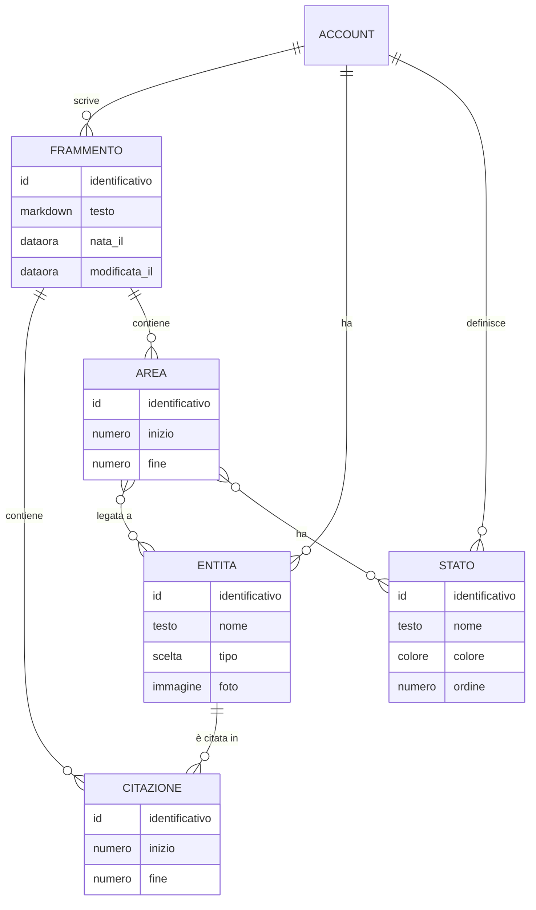

# Brainet – Entità

<!-- Fase 3 della guida. Scritte dall'agente il 14/10/2026 dai flussi FL-16 … FL-22 e dalle regole RB-101 … RB-113; approvate da Manuel Cucca il 14/10/2026, con le proposte dell'agente. «Entità» qui ha due sensi: EN-13 Entità è la persona, l'oggetto, l'evento o l'argomento di cui si parla (la voce Entità della colonna); EN-12 … EN-16 sono le entità del modello dei dati. -->

## Diagramma ER

## EN-12 – Frammento
**Descrizione:** una nota Brainet: il testo scritto in un foglio aperto con il + (RB-101) o importato da CLOUD (RB-112). Si legge e si modifica solo dal Database (RB-103).

| Attributo | Tipo | Obbligatorio | Vincoli | Note |
|---|---|---|---|---|
| Identificativo | Codice | Sì | Unico e stabile | Tecnico |
| Testo | Markdown | Sì | Non vuoto; fino a 4 MB come le note (DEC-106) | Pillole e aree sono scritte nel testo con segni nascosti, così si spostano con le parole; EN-14 ed EN-15 sono l'indice ricavato dal testo (scelta di Manuel Cucca del 15/10/2026, Fase 7; prima stavano fuori dal testo) |
| Nato il | Data e ora | Sì | | Il giorno del Calendario (RB-103); per una nota importata, la data di creazione della nota (RB-112) |
| Modificato il | Data e ora | Sì | | Non sposta il giorno nel Calendario |

- **Chi lo crea:** l'utente, scrivendo; il sistema, importando una nota.
- **Chi lo modifica:** l'utente, dal Database.
- **Cancellazione:** un singolo frammento si elimina dal Database con il tasto destro, «Elimina»: va nel Cestino, in una parte dedicata a Brainet, e con lui spariscono le sue citazioni e le sue aree; dal Cestino si ripristina o si elimina per sempre (scelta di Manuel Cucca del 14/10/2026). Spegnendo Brainet, tutto definitivamente (RB-111).
- **Dati sensibili:** tutto il testo; cifrato end-to-end come le note (RF-10).

## EN-13 – Entità
**Descrizione:** una persona, un oggetto, un evento, un argomento, o una cosa ancora senza tipo, citata nei frammenti o legata alle aree (RB-104, RB-105).

| Attributo | Tipo | Obbligatorio | Vincoli | Note |
|---|---|---|---|---|
| Identificativo | Codice | Sì | Unico e stabile | Tecnico |
| Nome | Testo | Sì | Fino a 200 caratteri (proposta dell'agente) | Il nome della pillola |
| Tipo | Persona \| Oggetto \| Evento \| Argomento \| nessuno | No | | Nasce senza tipo con «Crea» (RB-105); dove si assegna è da decidere |
| Foto | Immagine | No | | La sceglie l'utente dal disco, in Entità, con il tasto destro sulla riga, «Scegli una foto…», per qualsiasi entità; se c'è, la pillola la mostra, altrimenti solo il nome (scelta di Manuel Cucca del 14/10/2026) |
| Unita in | EN-13 | No | | Dopo «Unisci a…» punta all'entità che resta, per le citazioni che arrivano dopo da un altro computer (RB-108) |

- **Chi la crea:** l'utente, con «Crea» nel menu di @ o della selezione.
- **Chi la modifica:** l'utente: unione (RB-108), tipo, foto.
- **Cancellazione:** con l'unione resta solo come rimando (proposta dell'agente); spegnendo Brainet, definitiva.
- **Dati sensibili:** nomi di persone e foto; cifrati end-to-end.

## EN-14 – Citazione
**Descrizione:** una pillola: il punto di un frammento in cui un'entità è nominata (RB-104). Non ha un'area.

| Attributo | Tipo | Obbligatorio | Vincoli | Note |
|---|---|---|---|---|
| Frammento | EN-12 | Sì | | |
| Entità | EN-13 | Sì | | |
| Posizione | Inizio e fine nel testo | Sì | Dentro il testo del frammento | Il segno sta nel testo e si sposta con lui (15/10/2026) |

- **Chi la crea:** l'utente con @; **chi la modifica:** il sistema, quando il testo cambia o le entità si uniscono; **cancellazione:** Backspace subito dopo la pillola (RB-104).

## EN-15 – Area
**Descrizione:** una frase evidenziata di un frammento, legata a uno o più stati ed entità (RB-107).

| Attributo | Tipo | Obbligatorio | Vincoli | Note |
|---|---|---|---|---|
| Frammento | EN-12 | Sì | | |
| Posizione | Inizio e fine nel testo | Sì | | Il segno sta nel testo, con stati ed entità; due aree possono sovrapporsi (FL-18) |
| Entità | EN-13, da 0 a molte | | Almeno un legame tra entità e stati | Comprende da sola le entità citate dentro l'area (RB-107) |
| Stati | EN-16, da 0 a molti | | | |

- **Chi la crea:** l'utente, selezionando; **chi la modifica:** l'utente, dalla linguetta (RB-109); **cancellazione:** quando perde l'ultimo legame (RB-109, RB-110) o la sua frase sparisce (FL-18).

## EN-16 – Stato
**Descrizione:** un'etichetta personale per le aree, con un colore, per esempio «Importante» (RB-110).

| Attributo | Tipo | Obbligatorio | Vincoli | Note |
|---|---|---|---|---|
| Nome | Testo | Sì | Unico tra gli stati | |
| Colore | Uno dei colori di stato del design system | Sì | | Proposta dell'agente: avviso, informazione, successo, errore |
| Ordine | Numero | Sì | | L'ordine nel menu e nelle Impostazioni |

- **Chi lo crea e lo modifica:** l'utente, nelle Impostazioni; **cancellazione:** «Togli», con la proposta di cambiarlo (RB-110).

## Impostazioni di Brainet (in EN-07)
| Attributo | Tipo | Note |
|---|---|---|
| Usa Brainet | Sì \| No | Vale per tutti i computer: spegnere cancella tutto (RB-111). Di default No (proposta dell'agente) |
| Mostra il Database | Sì \| No | Vale per tutti i computer e si sincronizza (scelta di Manuel Cucca del 14/10/2026). Di default Sì (proposta dell'agente) |

## Da decidere
- ~~Da dove arriva la foto di un'entità.~~ Dal disco, scelta dall'utente in Entità, per tutte le entità (14/10/2026).
- ~~Se «Mostra il Database» vale solo per questo computer o per tutti.~~ Per tutti (14/10/2026).
- ~~Se un singolo frammento si può eliminare dal Database.~~ Sì, nel Cestino, in una parte dedicata a Brainet (14/10/2026).
