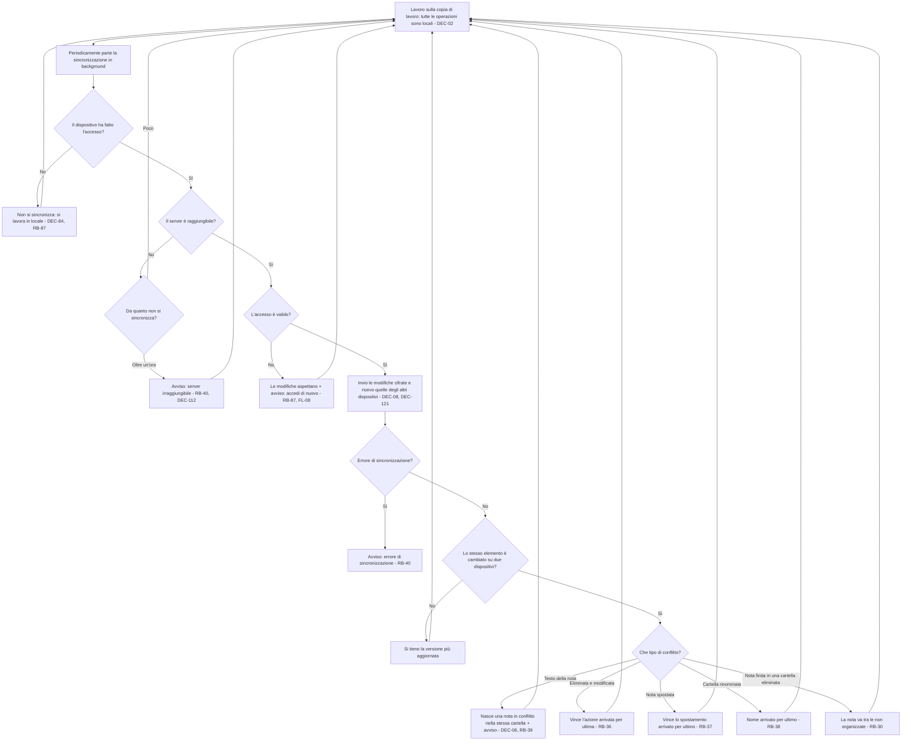
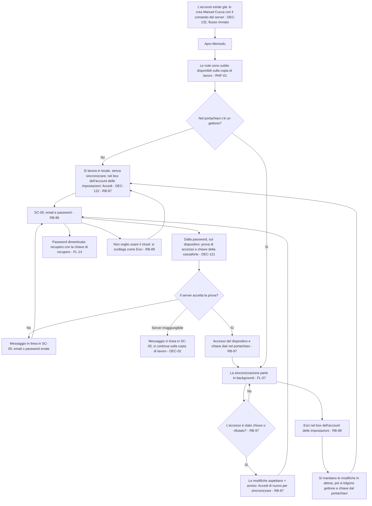
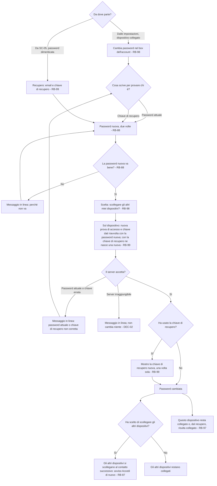
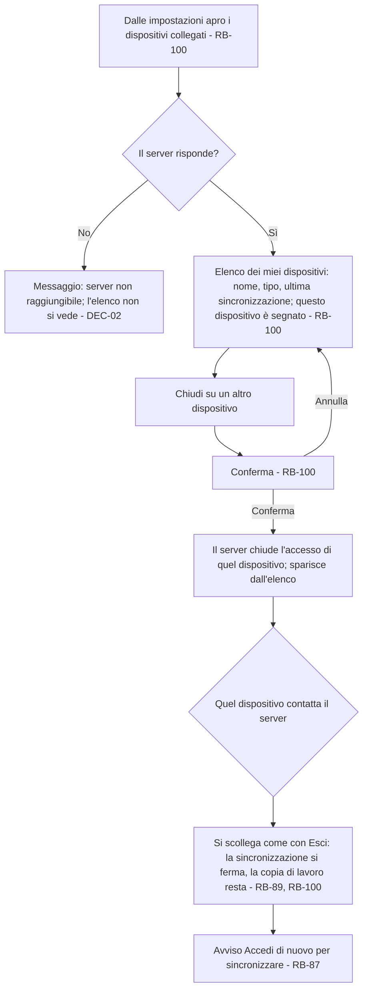

# Sincronizzazione – Flussi

<!-- Fase 2 della guida. I diagrammi si scrivono in Mermaid. -->

## FL-07 – Sincronizzare
**Requisito:** RF-10 · **Attori:** Utente, Sistema (sincronizzazione in background)

### Percorsi alternativi
- **Senza rete:** si continua a scrivere; le modifiche partono appena la rete torna (DEC-02).
- **Nessun problema:** la sincronizzazione è invisibile, non c'è nessun indicatore (RB-40).

### Sfighe gestite
| Sfiga | Rilevamento | Comunicazione | Via d'uscita |
|---|---|---|---|
| SF-08 Connessione che cade a metà | La sincronizzazione non si completa | Nessun messaggio, se dura poco | Riprova alla sincronizzazione successiva (DEC-02) |
| SF-20 Riferimenti spariti | Nota creata o spostata in una cartella eliminata altrove | Nessun messaggio | La nota va tra le non organizzate, la cartella resta nel cestino (RB-30) |
| SF-22 Modifica simultanea | Lo stesso elemento cambiato su due dispositivi | Avviso solo per le note in conflitto (RB-39) | DEC-06, RB-36, RB-37, RB-38 |
| SF-25 Accesso revocato | Il server rifiuta il gettone | Avviso «Accedi di nuovo per sincronizzare» (RB-87) | Si accede di nuovo in SC-05 (FL-08); le modifiche partono dopo l'accesso |
| SF-12 Sessione scaduta | Il gettone è scaduto | Come SF-25 (RB-87) | Come SF-25: niente va perso, le modifiche restano sulla copia di lavoro |
| SF-30 Servizio esterno fuori uso | Server irraggiungibile da più di un'ora (DEC-112) | Avviso (RB-40) | Le modifiche restano sulla copia di lavoro finché il server non torna |
| SF-31 Notifiche perse | Un conflitto avviene mentre l'utente non guarda | L'avviso resta finché non lo si chiude o non si chiude la finestra (DEC-90) | La nota in conflitto resta nella cartella, riconoscibile dal titolo (DEC-06) |
| SF-33 Versioni diverse di app e server | Il server non riconosce la versione del protocollo | Avviso: errore di sincronizzazione (RB-40) | Si continua sulla copia di lavoro; si riparte da soli quando le versioni tornano compatibili (DEC-83) |
| SF-32 Errore a metà operazione | Errore durante l'invio o la ricezione | Avviso (RB-40) | Riprova alla sincronizzazione successiva; la copia di lavoro resta intatta |

### Sfighe considerate e scartate
- SF-01 … SF-07: la sincronizzazione non richiede azioni dell'utente.
- SF-34 … SF-36: il contenuto viaggia cifrato end-to-end e il server non lo legge (RNF-02, DEC-121); l'accesso è trattato in FL-08.

---

## FL-08 – Accedere e uscire
**Requisito:** RF-14 · **Attori:** Utente, Sistema · **Aggiornato:** 14/10/2026 per gli account nel database (DEC-132)

### Percorsi alternativi
- **Mai fatto l'accesso:** si lavora in locale sulla copia di lavoro, senza sincronizzare e senza blocco (DEC-84, RB-87).
- **Accesso chiuso o rifiutato** (chiuso a distanza, FL-15, o scollegato da un cambio della password, FL-14): non si blocca niente: si continua a scrivere, le modifiche aspettano e l'avviso porta a SC-05; dopo l'accesso si sincronizza tutto (RB-87). Vale anche per la nota rapida.
- **Nessuna scadenza:** l'accesso del dispositivo non scade; dura finché si esce o finché lo si chiude a distanza (RB-97). Sostituisce il gettone di 30 giorni di RB-86.
- **Server irraggiungibile:** non blocca; si lavora sulla copia di lavoro (DEC-02, RB-40).
- **Password persa:** da SC-05, con la chiave di recupero se ne sceglie una nuova (FL-14, RB-99).
- **Dispositivo perso:** da un altro dispositivo lo si chiude a distanza (FL-15, RB-100).
- **Uscire:** «Esci» manda le modifiche in attesa, poi scollega; la copia di lavoro resta (RB-89).
- **Non voglio usare il cloud:** in SC-05 scollega come «Esci»; con il gettone scaduto le modifiche in attesa restano sulla copia di lavoro e l'avviso non torna (RB-89).

### Sfighe gestite
| Sfiga | Rilevamento | Comunicazione | Via d'uscita |
|---|---|---|---|
| SF-07 Dimenticanze | Password dimenticata | Messaggio in linea in SC-05 per le credenziali errate | Chiave di recupero (RB-90) |
| SF-12 Sessione scaduta | Non succede più: l'accesso non scade (RB-97) | — | — |
| SF-25 Accesso revocato | Il server rifiuta l'accesso del dispositivo (chiuso a distanza o scollegato da un cambio della password) | Avviso «Accedi di nuovo per sincronizzare» (RB-87) | Si accede di nuovo; le modifiche restano sulla copia di lavoro |
| SF-35 Tentativi ripetuti | Molte prove sbagliate | Nessuna, durante la prova | Nessun limite ai tentativi durante la prova (DEC-132, rischio in `avanzamento.md`); ogni prova costa un calcolo Argon2id e la password ha almeno 12 caratteri (RB-88) |

### Sfighe considerate e scartate
- SF-01 Doppio invio: accedere due volte non crea nulla di diverso.
- SF-19 Duplicati, SF-27 Account non verificato: gli account li crea Manuel Cucca con il comando del server, senza registrazione dall'app (DEC-132).
- SF-34 Manipolazione di ID: il server riconosce l'account dall'accesso del dispositivo, non da quello che l'app gli dice; un dispositivo legge e scrive solo i blocchi del suo account (RF-10, DEC-132).
- SF-26 Accesso via link diretto: il web è rinviato (ID-19).
- SF-36 Input malevolo: email e password non vengono eseguite né mostrate (RB-08).
- Le altre sfighe non riguardano l'accesso.

---

## FL-14 – Cambiare la password o recuperare l'account
**Requisito:** RF-14 · **Attori:** Utente, Sistema · **Origine:** DEC-132

### Percorsi alternativi
- **Cambio con la password attuale:** dal box dell'account, con il dispositivo collegato. La chiave di recupero resta quella di prima.
- **Cambio con la chiave di recupero:** come sopra, ma al posto della password attuale si scrive la chiave di recupero; alla fine nasce una chiave nuova e quella usata smette di valere (RB-99).
- **Recupero da SC-05:** chi non ricorda la password scrive email, chiave di recupero e password nuova; alla fine il dispositivo risulta collegato, come dopo un accesso.
- **Le note non si ricifrano:** cambia solo come è avvolta la chiave dati (DEC-121).

### Sfighe gestite
| Sfiga | Rilevamento | Comunicazione | Via d'uscita |
|---|---|---|---|
| SF-01 Doppio invio | Il pulsante va in caricamento al primo clic | Nessuna | Il secondo clic non parte |
| SF-02 Abbandono a metà | La finestra si chiude prima della conferma | Nessuna | Non cambia niente: password e chiave restano quelle di prima |
| SF-07 Dimenticanze | Password attuale dimenticata, nel cambio | Messaggio in linea | Si usa la chiave di recupero; persi password e chiave, le note sul server non si recuperano (RB-90) |
| SF-08, SF-10 Connessione che cade o app chiusa a metà | Il server ha cambiato la password ma la risposta non arriva | Messaggio in linea come per il server irraggiungibile | La richiesta si può ripetere uguale e il server dà lo stesso esito; la chiave di recupero nuova si mostra solo dopo la conferma del server |
| SF-22 Modifica simultanea | Cambio della password su due dispositivi insieme | Nessuna | Vale l'ultimo cambio arrivato al server; l'altro dispositivo, se scollegato, rifà l'accesso |
| SF-25 Accesso revocato | Il dispositivo è stato chiuso a distanza mentre si cambia la password | Avviso «Accedi di nuovo per sincronizzare» (RB-87) | Si rifà l'accesso, poi il cambio |
| SF-30 Servizio fuori uso | Server irraggiungibile | Messaggio in linea | Non cambia niente; si riprova più tardi |
| SF-35 Tentativi ripetuti | Molte prove sbagliate | Nessuna, durante la prova | Nessun limite durante la prova (DEC-132); la chiave di recupero è lunga e casuale |

### Sfighe considerate e scartate
- SF-03, SF-04, SF-11, SF-26: app desktop, il web è rinviato (ID-19).
- SF-06 Input strani: la password accetta qualsiasi carattere; spazi all'inizio e alla fine della chiave di recupero si ignorano.
- SF-36 Input malevolo: password e chiave non vengono eseguite né mostrate (RB-08).
- Le altre sfighe non riguardano il cambio della password.

---

## FL-15 – Vedere i dispositivi e chiuderne uno a distanza
**Requisito:** RF-16 · **Attori:** Utente, Sistema · **Origine:** DEC-132

### Percorsi alternativi
- **Questo dispositivo:** si scollega con «Esci», non dall'elenco (RB-89).
- **Dispositivo spento o senza rete:** l'accesso è chiuso subito sul server; il dispositivo si scollega quando torna in rete. Le modifiche fatte lì nel frattempo restano sulla sua copia di lavoro e non arrivano sul server.
- **Rifare l'accesso:** con email e password il dispositivo chiuso si ricollega, come un dispositivo nuovo.

### Sfighe gestite
| Sfiga | Rilevamento | Comunicazione | Via d'uscita |
|---|---|---|---|
| SF-01 Doppio invio | Il pulsante va in caricamento al primo clic | Nessuna | Chiudere un accesso già chiuso non cambia niente |
| SF-05 Cambio idea | Chiudi premuto per errore | Conferma prima di chiudere | Dopo, si rifà l'accesso su quel dispositivo |
| SF-16 Vuoto | C'è solo questo dispositivo | Elenco con una riga | — |
| SF-20 Riferimenti spariti | Il dispositivo è già stato chiuso da un altro | Nessuna | L'elenco si aggiorna |
| SF-22 Modifica simultanea | Due dispositivi si chiudono a vicenda | Nessuna | Restano chiusi tutti e due; si rifà l'accesso |
| SF-30 Servizio fuori uso | Server irraggiungibile | Messaggio in linea | Si riprova più tardi |
| SF-34 Manipolazione di ID | Un dispositivo prova a chiudere quello di un altro account | Nessuna | Il server chiude solo dispositivi dell'account che lo chiede |
| SF-42 Fatti successi ad app chiusa | Il dispositivo è stato chiuso mentre Memodu era spento | Avviso alla prima sincronizzazione dopo la riapertura (RB-87) | Si rifà l'accesso o si lavora in locale |

### Sfighe considerate e scartate
- SF-17 Troppo: pochi dispositivi per persona.
- SF-26 Accesso via link diretto: il web è rinviato (ID-19).
- Le altre sfighe non riguardano l'elenco dei dispositivi.

---

## Regole di business
| Codice | Regola | Usata in |
|---|---|---|
| RB-36 | Se una nota è stata eliminata su un dispositivo e modificata su un altro, vince l'azione arrivata per ultima al server (DEC-109): se è la modifica, la nota esce dal cestino con le modifiche; se è l'eliminazione, la nota resta nel cestino con le modifiche comprese | FL-07 |
| RB-37 | Se una nota è stata spostata in cartelle diverse su due dispositivi, resta nella cartella dello spostamento arrivato per ultimo al server (DEC-109) | FL-07 |
| RB-38 | Se una cartella è stata rinominata in modo diverso su due dispositivi, prende il nome arrivato per ultimo al server (DEC-109), senza cartella vuota con l'altro (DEC-110) | FL-07 |
| RB-39 | Quando nasce una nota in conflitto (DEC-06) compare un avviso con il collegamento alla nota. La nota in conflitto ha lo stesso titolo seguito da "(copia in conflitto)" | FL-07 |
| RB-40 | La sincronizzazione è invisibile finché va tutto bene. Compare un avviso solo per: errore di sincronizzazione (subito), server irraggiungibile per più di un'ora dall'ultima sincronizzazione riuscita (DEC-112) | FL-07 |
| RB-41 | ~~Uscendo (logout), le modifiche in attesa vengono sincronizzate e poi la copia di lavoro su quel dispositivo viene cancellata~~ Superata da DEC-13 | — |
| RB-42 | ~~Non c'è limite ai tentativi di accesso con password sbagliata (rischio accettato, DEC-07)~~ Superata da DEC-13 | — |
| RB-43 | ~~La password non ha requisiti di lunghezza o complessità (rischio accettato, DEC-07)~~ Superata da DEC-13 | — |
| RB-44 | ~~Se all'uscita ci sono modifiche non sincronizzate, l'uscita avviene subito ma la copia di lavoro resta, cifrata e illeggibile senza password, finché le modifiche non si sincronizzano; poi si cancella. Sul web la sincronizzazione può riprendere solo quando Memodu viene riaperto in quel browser~~ Superata da DEC-13 | — |
| RB-50 | ~~Email e password si cambiano dalle impostazioni inserendo la password attuale. Cambiando password le note vengono ricifrate e gli altri dispositivi devono accedere di nuovo~~ Superata da DEC-13 | — |
| RB-51 | Il nome di un dispositivo viene preso dal sistema (es. nome del PC) e si può cambiare dalle impostazioni | FL-07, FL-08 |
| RB-53 | ~~Gli avvisi si sincronizzano: compaiono su tutti i dispositivi e, visti su uno, non si mostrano più su nessuno~~ Superata da DEC-90: gli avvisi restano sul dispositivo in cui nascono | — |
| RB-54 | ~~Un dispositivo si collega all'installazione con le credenziali scritte nel file di configurazione dell'app all'installazione: non ci sono login, email, password né uscita (DEC-13)~~ Superata da DEC-121 | — |
| RB-57 | ~~Con credenziali rifiutate dal server la finestra principale e la nota rapida non si aprono: al loro posto c'è la schermata di blocco con Riprova, che rilegge la configurazione. Il server irraggiungibile non blocca (DEC-02); senza il file delle credenziali si lavora in locale senza sincronizzare (DEC-84). Quello che era scritto resta sulla copia di lavoro (DEC-20)~~ Superata da DEC-121: vedi RB-87 | — |
| RB-86 | ~~Si accede in SC-05 con email e password dell'utente fisso (DEC-121). Dalla password, sul dispositivo, si ricavano la prova di accesso per il server e la chiave che apre la chiave dati; il server restituisce un gettone di 30 giorni, che l'app rinnova da sola quando ne mancano meno di 7. Gettone e chiave dati restano nel portachiavi del sistema~~ Superata da RB-97 (DEC-132) | — |
| RB-87 | Senza un gettone valido la finestra non si blocca mai. Mai fatto l'accesso: si lavora in locale e il box dell'account delle impostazioni dice «Non hai fatto l'accesso» con Accedi (DEC-122). Gettone scaduto o rifiutato: si continua a scrivere, le modifiche aspettano e l'avviso «Accedi di nuovo per sincronizzare» apre SC-05; dopo l'accesso si sincronizza tutto (DEC-121) | FL-07, FL-08 |
| RB-88 | La password ha almeno 12 caratteri, nessuna regola di complessità e non può essere tra le più comuni (elenco breve nel programma). La controlla il comando che crea l'utente (DEC-121) e l'app quando si cambia la password o si recupera l'account (DEC-132) | FL-08, FL-14 |
| RB-89 | «Esci», nel box dell'account delle impostazioni (SC-06, DEC-122), manda le modifiche in attesa e poi toglie gettone e chiave dati dal portachiavi: il dispositivo lavora in locale senza sincronizzare. La copia di lavoro resta (DEC-121). «Non voglio usare il cloud» in SC-05 fa lo stesso (scelta di Manuel Cucca il 06/10/2026): se il gettone non vale più, le modifiche in attesa restano sulla copia di lavoro e partono al prossimo accesso; l'avviso «Accedi di nuovo» non torna | FL-08 |
| RB-90 | Creando l'utente nasce una chiave di recupero, mostrata una volta per stamparla: con questa si sceglie una password nuova senza perdere le note. Persi la password e la chiave di recupero, le note sul server non si recuperano (DEC-121) | FL-08 |
| RB-97 | Si accede in SC-05 con email e password del proprio account (DEC-132). Dalla password, sul dispositivo, si ricavano la prova di accesso per il server e la chiave che apre la chiave dati. Ogni dispositivo riceve il suo accesso, che non scade: dura finché si esce (RB-89), finché lo si chiude a distanza (RB-100) o finché un cambio della password scollega gli altri dispositivi (RB-98). Il server ne tiene solo l'impronta. Accesso e chiave dati restano nel portachiavi del sistema | FL-08, FL-14, FL-15 |
| RB-98 | La password si cambia dal box dell'account delle impostazioni, con il dispositivo collegato, scrivendo la password attuale oppure la chiave di recupero, poi quella nuova due volte. Prima di confermare si sceglie se scollegare gli altri propri dispositivi; questo resta collegato. Le note non si ricifrano. Senza rete non si cambia (scelte di Manuel Cucca del 13 e 14/10/2026) | FL-14 |
| RB-99 | Da SC-05 chi ha dimenticato la password recupera l'account con email, chiave di recupero e password nuova, e sceglie se scollegare gli altri dispositivi, come in RB-98. Ogni volta che si usa la chiave di recupero (recupero o cambio della password) ne nasce una nuova, mostrata una volta sola dopo la conferma del server, e quella usata smette di valere. Durante la prova l'utente la consegna a voce a Manuel Cucca: l'app non lo dice (scelte di Manuel Cucca del 13 e 14/10/2026 e del 15/10/2026, DEC-140) | FL-14 |
| RB-100 | Dalle impostazioni si vede l'elenco dei propri dispositivi collegati (nome, tipo, ultima sincronizzazione; questo dispositivo è segnato) e se ne chiude uno diverso da questo, dopo una conferma. Il server chiude subito il suo accesso; quel dispositivo, al contatto successivo, si scollega come con «Esci»: la copia di lavoro resta (scelta di Manuel Cucca del 14/10/2026) | FL-15 |
