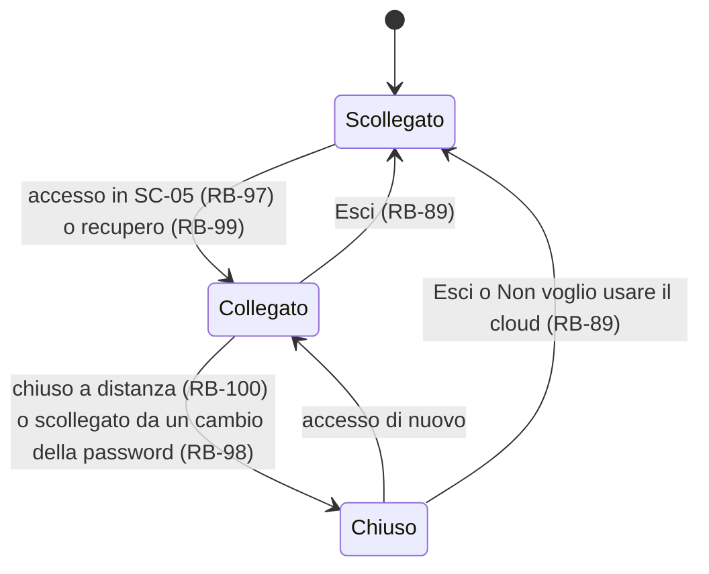

# Sincronizzazione – Entità

<!-- Fase 3 della guida. -->

## Diagramma ER
Il diagramma di tutto il sistema è in `moduli/note/3-entita.md`.

## EN-05 – Account
**Descrizione:** una persona che usa Memodu. Durante la prova ci sono più account, uno per persona, in una tabella del server (DEC-132); prima c'era solo l'utente fisso, con i dati nelle variabili d'ambiente (DEC-121), che diventa il primo account con la stessa chiave dati.

| Attributo | Tipo | Obbligatorio | Vincoli | Note |
|---|---|---|---|---|
| Identificativo | Codice | Sì | Unico e stabile | Tecnico, non visibile. Lega all'account dispositivi, blocchi e versioni (RF-10) |
| Email | Testo | Sì | Unica tra gli account; si confronta senza maiuscole e spazi | Serve ad accedere (RB-97) e al recupero (RB-99) |
| Sale e parametri di Argon2id | Tecnico | Sì | Sale casuale; 64 MiB, 3 passaggi, 1 filo (DEC-121) | Il server li dà prima dell'accesso; i parametri si possono alzare. Cambiano con la password |
| Impronta della prova di accesso | Tecnico | Sì | SHA-256 | La prova si ricava dalla password sul dispositivo; il server non vede mai la password. Cambia con la password (RB-98) |
| Impronta della prova di recupero | Tecnico | Sì | SHA-256 | La prova si ricava dalla chiave di recupero; cambia ogni volta che la chiave si usa (RB-99) |
| Chiave dati avvolta con la password | Segreto | Sì | | La chiave che cifra le note, illeggibile senza la password (DEC-08, DEC-121). Si riavvolge al cambio della password: le note non si ricifrano |
| Chiave dati avvolta con la chiave di recupero | Segreto | Sì | | La stessa chiave dati; si riavvolge quando nasce una chiave di recupero nuova (RB-99) |
| Data di creazione | Data e ora | Sì | | Quando il comando crea l'account |

La password e la chiave di recupero non sono attributi: non lasciano il dispositivo, il foglio della persona e la copia che conserva Manuel Cucca durante la prova.

- **Chi lo crea:** Manuel Cucca, con il comando del server (DEC-132); l'app non crea account. Il flusso della creazione è rinviato (`avanzamento.md`).
- **Chi lo modifica:** la persona dall'app, cambiando la password o recuperando l'account (FL-14, RB-98, RB-99); l'email non si cambia dall'app.
- **Cancellazione:** non prevista dall'app.
- **Dati sensibili:** tutti; con questi dati il server non legge le note (DEC-121). Ogni account vede solo i suoi dati (RF-10). Rischi: chi ha la chiave di recupero legge tutte le note, e durante la prova Manuel Cucca le conserva tutte (DEC-132); persi password e chiave di recupero, le note sul server non si recuperano.

## EN-06 – Dispositivo
**Descrizione:** un computer da cui una persona usa Memodu con il suo account (FL-07, FL-08, FL-15).

| Attributo | Tipo | Obbligatorio | Vincoli | Note |
|---|---|---|---|---|
| Identificativo | Codice | Sì | Unico e stabile | Tecnico, non visibile |
| Account | EN-05 | No | Uno solo alla volta | Assente quando il dispositivo è scollegato |
| Nome | Testo | Sì | | Preso dal sistema (es. nome del PC), modificabile (RB-51). Arriva sul server cifrato, per l'elenco dei dispositivi (RB-100) |
| Tipo | Windows \| macOS | Sì | Piattaforme della prima fase (DEC-13) | Mostrato nell'elenco dei dispositivi (RB-100) |
| Ultima sincronizzazione | Data e ora | No | | Sul dispositivo per l'avviso di RB-40; sul server per l'elenco dei dispositivi (RB-100) |
| Modifiche in attesa | Numero | Sì | | Modifiche non ancora arrivate al server; solo sul dispositivo |
| Accesso del dispositivo | Segreto | No | Sul dispositivo nel portachiavi del sistema, mai nella copia di lavoro; sul server solo l'impronta | Nasce all'accesso e non scade (RB-97); sparisce con Esci, con la chiusura a distanza o con un cambio della password che scollega gli altri dispositivi (RB-89, RB-98, RB-100) |
| Chiave dati | Segreto | No | Nel portachiavi del sistema | C'è dopo l'accesso, sparisce scollegandosi (RB-89) |

- **Chi lo crea:** il sistema, all'accesso da quel dispositivo (FL-08).
- **Chi lo modifica:** il sistema; la persona, per il nome (RB-51).
- **Cancellazione:** sul server il dispositivo sparisce dall'elenco quando esce, quando lo si chiude a distanza o quando un cambio della password lo scollega (RB-89, RB-98, RB-100); sul dispositivo la copia di lavoro resta sempre.
- **Dati sensibili:** il nome del dispositivo è cifrato end-to-end (DEC-08); tipo e ultima sincronizzazione il server li vede.

## EN-08 – Avviso
**Descrizione:** un avviso mostrato all'utente dalla sincronizzazione (RB-39, RB-40). Vive nella finestra del dispositivo in cui nasce: non si sincronizza e non si conserva, chiusa la finestra sparisce (DEC-90).

| Attributo | Tipo | Obbligatorio | Vincoli | Note |
|---|---|---|---|---|
| Identificativo | Codice | Sì | Unico e stabile | Tecnico, non visibile |
| Tipo | nota in conflitto \| errore di sincronizzazione \| server irraggiungibile \| accesso scaduto | Sì | | RB-39, RB-40, RB-87 |
| Nota collegata | EN-01 | No | Solo per il tipo "nota in conflitto" | Il collegamento dell'avviso (RB-39) |
| Dispositivo | EN-06 | Sì | | Il dispositivo su cui è nato il problema |
| Data | Data e ora | Sì | | |

Il testo dell'avviso non è un attributo: dipende dal tipo e si scrive in Fase 6.

- **Chi lo crea:** il sistema (FL-07).
- **Chi lo modifica:** nessuno; l'utente lo chiude.
- **Cancellazione:** sparisce quando l'utente lo chiude o quando si chiude la finestra (DEC-90).
- **Dati sensibili:** non lascia il dispositivo (DEC-90).

## Diagrammi a stati
EN-06 Dispositivo, rispetto all'accesso (DEC-121, aggiornato per DEC-132):

In tutti gli stati si lavora sulla copia di lavoro; si sincronizza solo da Collegato. Lo stato Chiuso il dispositivo lo scopre al primo contatto con il server, che rifiuta l'accesso: compare l'avviso «Accedi di nuovo per sincronizzare» (RB-87). Lo stato Scaduto di prima non c'è più: l'accesso non scade (RB-97).
