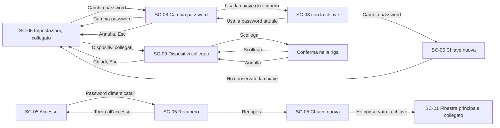

# Sincronizzazione – Schermate

<!-- Fasi 4 e 6 della guida. Wireframe e mockup restano nello strumento di design: qui si mettono i link. -->

L'impostazione generale è in `moduli/interfaccia/4-schermate.md`. La sincronizzazione è invisibile finché va tutto bene (RB-40). Le sue schermate sono SC-05 Accesso (DEC-121) e SC-07, che compare solo quando la copia di lavoro non si apre o non si scrive; senza accesso si lavora in locale e non si blocca mai (RB-87).

## Avvisi di sincronizzazione (FL-07)
**Flussi:** FL-07 · **Componenti:** avviso

- **Wireframe:** [i due avvisi](https://www.figma.com/design/ioeRDMTxu3TEMoLN8rinAK/Memodu--Wireframe--Fase-4-?node-id=38-130) · [nota in conflitto](https://www.figma.com/design/ioeRDMTxu3TEMoLN8rinAK/Memodu--Wireframe--Fase-4-?node-id=32-147) · [accesso scaduto](https://www.figma.com/design/ioeRDMTxu3TEMoLN8rinAK/Memodu--Wireframe--Fase-4-?node-id=38-211)
- **Esportazioni:** `immagini/SC-01-avvisi.png`, `immagini/SC-01-accesso-scaduto.png`
- **Mockup dell'accesso scaduto (approvato da Manuel Cucca il 06/10/2026):** [accesso scaduto](https://www.figma.com/design/18288YdcRf5vtWCtEefQYJ?node-id=210-3289); esportazione `immagini/SC-01-accesso-scaduto-mockup.png`

Al centro dell'area della nota di SC-01, 8 sotto la fascia in alto (DEC-86), livello 50, uno alla volta:

| Avviso | Quando | Azione |
|---|---|---|
| Server irraggiungibile | Oltre un'ora dall'ultima sincronizzazione riuscita (RB-40, DEC-112) | Ho capito |
| Errore di sincronizzazione | Subito (SF-32) | Ho capito |
| Nota in conflitto | Subito (RB-39) | Apri l'altra |
| Accesso scaduto | Gettone scaduto o rifiutato (RB-87) | Accedi, che apre SC-05; Ho capito |

L'avviso resta sul dispositivo in cui nasce (DEC-90). L'avviso dell'accesso scaduto è del tipo Avviso (CMP-15), con il testo definitivo «Accedi di nuovo per sincronizzare. Le modifiche restano su questo computer.» (approvato da Manuel Cucca il 06/10/2026).

---

## SC-07 – Collegamento bloccato
**Flussi:** FL-08 · **Componenti:** stato vuoto (variante Blocco), pulsante

- **Wireframe:** [collegamento bloccato](https://www.figma.com/design/ioeRDMTxu3TEMoLN8rinAK/Memodu--Wireframe--Fase-4-?node-id=51-169) *(rimosso dal file il 14/10/2026)*
- **Esportazioni:** `immagini/SC-07.png`
- **Mockup:** [Fase 6]

Al posto della finestra principale e della nota rapida quando la copia di lavoro non si apre o non si scrive (DEC-67) e nell'interfaccia aperta nel browser, che non ha il nucleo (DEC-85). Non compare più per le credenziali: senza un gettone valido si lavora in locale (RB-87, DEC-121). Finestra vuota con, al centro, icona di errore, «Memodu non riesce a collegarsi», una riga che spiega cosa correggere e il pulsante Riprova, con la spiegazione «Memodu non riesce a salvare le note su questo computer. Premi Riprova; se non basta, controlla lo spazio sul disco.» (DEC-127). Compare anche quando una nota supera 4 MB (DEC-106): un avviso che lasci la nota modificabile è ID-36.

### Stati della schermata
| Stato | Descrizione | Testo mostrato |
|---|---|---|
| Vuoto | Non previsto | — |
| Caricamento | Dopo Riprova, il pulsante in caricamento | — |
| Errore | È la schermata stessa; se Riprova fallisce resta com'è | Testo definitivo in Fase 6 |
| Successo | La copia di lavoro si apre: si apre SC-01 | — |

---

## SC-05 – Accesso
**Flussi:** FL-08, FL-14 · **Componenti:** modulo di accesso (CMP-22), campo di testo con password (CMP-03), pulsante, messaggio in linea

- **Wireframe:** [accesso](https://www.figma.com/design/ioeRDMTxu3TEMoLN8rinAK/Memodu--Wireframe--Fase-4-?node-id=38-181) · [email o password errate](https://www.figma.com/design/ioeRDMTxu3TEMoLN8rinAK/Memodu--Wireframe--Fase-4-?node-id=38-196) (approvati da Manuel Cucca il 06/10/2026)
- **Esportazioni:** `immagini/SC-05.png`, `immagini/SC-05-errore.png`
- **Wireframe del recupero (DEC-132, approvati da Manuel Cucca il 14/10/2026):** [recupero](https://www.figma.com/design/ioeRDMTxu3TEMoLN8rinAK/Memodu--Wireframe--Fase-4-?node-id=85-195) · [chiave di recupero nuova](https://www.figma.com/design/ioeRDMTxu3TEMoLN8rinAK/Memodu--Wireframe--Fase-4-?node-id=85-280); esportazioni `immagini/SC-05-recupero.png`, `immagini/SC-05-chiave-nuova.png`. Nell'accesso, sotto la password, il collegamento «Password dimenticata?» (anche nei due wireframe qui sopra, esportazioni rifatte il 14/10/2026)
- **Mockup del recupero (DEC-132, 14/10/2026, da approvare):** [recupero](https://www.figma.com/design/18288YdcRf5vtWCtEefQYJ?node-id=253-4210) · [chiave di recupero nuova](https://www.figma.com/design/18288YdcRf5vtWCtEefQYJ?node-id=253-4354); esportazioni `immagini/SC-05-recupero-mockup.png`, `immagini/SC-05-chiave-nuova-mockup.png`. I mockup dell'accesso e dell'errore sono aggiornati alla libreria con «Password dimenticata?», esportazioni rifatte il 14/10/2026
- **Mockup (approvati da Manuel Cucca il 06/10/2026):** [accesso](https://www.figma.com/design/18288YdcRf5vtWCtEefQYJ?node-id=210-2936) · [email o password errate](https://www.figma.com/design/18288YdcRf5vtWCtEefQYJ?node-id=210-3109); esportazioni `immagini/SC-05-mockup.png`, `immagini/SC-05-errore-mockup.png`

**Attiva con DEC-121**, che supera DEC-19. Si apre da «Accedi» nel box dell'account delle impostazioni (SC-06, DEC-122) o dall'avviso «Accedi di nuovo per sincronizzare» (RB-87); non compare all'avvio, che resta sulla copia di lavoro (RNF-01).

Finestra sopra le note velate (livello 40, scelta di Manuel Cucca il 06/10/2026): titolo «Accedi a Memodu», email, password e i pulsanti «Non voglio usare il cloud» e Accedi. «Non voglio usare il cloud» scollega il dispositivo come «Esci» (RB-89) e si torna alle note; Esc chiude soltanto la finestra, senza scollegare: un tasto premuto per sbaglio non deve far uscire (scelta di Manuel Cucca il 06/10/2026). L'app non crea l'account (lo crea il comando del server, DEC-121): il wireframe del primo avvio è caduto. Regole: RB-86, RB-88; nessun limite ai tentativi per ora.

### Stati della schermata
| Stato | Descrizione | Testo mostrato |
|---|---|---|
| Vuoto | Email e password vuote | «Accedi a Memodu», «Accedi alla tua installazione.»; pulsanti «Non voglio usare il cloud» e «Accedi» |
| Caricamento | Dopo Accedi, Accedi in caricamento mentre il dispositivo calcola Argon2id (circa mezzo secondo) e il server risponde | — |
| Errore | Email o password errate, oppure server irraggiungibile: messaggio in linea sopra i pulsanti | «Email o password non corrette.»; server irraggiungibile: «Non riesco a raggiungere il server. Riprova tra poco.» |
| Successo | Si torna dove si era e la sincronizzazione parte; si resta collegati (RB-86) | — |

**Recupero (DEC-132, FL-14, RB-99).** «Password dimenticata?» cambia il contenuto della stessa finestra (scelta di Manuel Cucca il 14/10/2026): titolo «Recupera l'account», una riga di spiegazione, email, chiave di recupero, password nuova due volte, la casella «Scollega gli altri miei dispositivi» e i pulsanti «Torna all'accesso» e «Recupera». Dopo la conferma del server la finestra mostra la chiave di recupero nuova, una volta sola, con «Copia» e il promemoria di mandarla a Manuel Cucca durante la prova; «Ho conservato la chiave» chiude e il dispositivo risulta collegato. La stessa schermata della chiave nuova chiude il cambio della password fatto con la chiave (SC-08). Testi: proposta dell'agente approvata con i wireframe il 14/10/2026, definitivi in Fase 6. La chiave vera ha 64 caratteri: sta su due righe a gruppi interi, in un carattere più piccolo (scelta di Manuel Cucca del 14/10/2026, CMP-34); wireframe ed esportazione aggiornati lo stesso giorno, mockup dopo la pubblicazione della libreria.

| Stato | Descrizione | Testo mostrato |
|---|---|---|
| Recupero, vuoto | Email già scritta se c'era nell'accesso | «Recupera l'account», «Scrivi la chiave di recupero e scegli una password nuova. Le tue note restano tutte.» |
| Recupero, caricamento | «Recupera» in caricamento | — |
| Recupero, errore | Chiave non corretta, password nuova non valida (RB-88) o server irraggiungibile: messaggio in linea sopra i pulsanti | «Chiave di recupero non corretta.»; per la password, il motivo; server: come nell'accesso |
| Chiave nuova | Dopo la conferma del server | «La tua nuova chiave di recupero», «La vedi solo adesso. Conservala: ti serve se dimentichi la password. Quella di prima non vale più.»; nessun promemoria su a chi darla (DEC-140) |

---

## SC-08 – Cambia password
**Flussi:** FL-14 · **Regole:** RB-88, RB-98, RB-99 · **Componenti:** finestra, campo di testo, collegamento, casella, messaggio in linea, pulsanti

- **Wireframe (DEC-132, approvati da Manuel Cucca il 14/10/2026):** [cambia password](https://www.figma.com/design/ioeRDMTxu3TEMoLN8rinAK/Memodu--Wireframe--Fase-4-?node-id=85-353) · [con la chiave di recupero, chiave non corretta](https://www.figma.com/design/ioeRDMTxu3TEMoLN8rinAK/Memodu--Wireframe--Fase-4-?node-id=85-477); esportazioni `immagini/SC-08.png`, `immagini/SC-08-chiave-errata.png`
- **Mockup (CMP-35, 14/10/2026, da approvare):** [cambia password](https://www.figma.com/design/18288YdcRf5vtWCtEefQYJ?node-id=253-16713) · [con la chiave di recupero](https://www.figma.com/design/18288YdcRf5vtWCtEefQYJ?node-id=253-16882) · [chiave non corretta](https://www.figma.com/design/18288YdcRf5vtWCtEefQYJ?node-id=253-16982); esportazioni `immagini/SC-08-mockup.png`, `immagini/SC-08-chiave-mockup.png`, `immagini/SC-08-chiave-errata-mockup.png`

Finestra sopra le impostazioni velate (livello 40), aperta da «Cambia password» nel box dell'account di SC-06 (scelta di Manuel Cucca il 14/10/2026). Campo della password attuale con sotto il collegamento «Usa la chiave di recupero», che lo scambia con il campo della chiave (e il collegamento diventa «Usa la password attuale»); password nuova due volte; casella «Scollega gli altri miei dispositivi»; «Annulla» e «Cambia password». Dopo un cambio fatto con la chiave si mostra la chiave nuova come in SC-05 (RB-99). Questo dispositivo resta collegato.

| Stato | Descrizione | Testo mostrato |
|---|---|---|
| Vuoto | Campi vuoti, casella spenta | «Cambia password» |
| Caricamento | «Cambia password» in caricamento | — |
| Errore | Password attuale o chiave non corretta, password nuova non valida (RB-88), le due nuove diverse, server irraggiungibile: messaggio in linea sopra i pulsanti | «Password attuale non corretta.», «Chiave di recupero non corretta.»; server: «Non riesco a raggiungere il server. Riprova tra poco.» |
| Successo | La finestra si chiude; con la chiave, prima la chiave nuova | — |

---

## SC-09 – Dispositivi collegati
**Flussi:** FL-15 · **Regole:** RB-100, RB-89 · **Componenti:** finestra, riquadro con righe, pulsanti, messaggio in linea

- **Wireframe (DEC-132, approvati da Manuel Cucca il 14/10/2026):** [elenco](https://www.figma.com/design/ioeRDMTxu3TEMoLN8rinAK/Memodu--Wireframe--Fase-4-?node-id=85-603) · [conferma](https://www.figma.com/design/ioeRDMTxu3TEMoLN8rinAK/Memodu--Wireframe--Fase-4-?node-id=85-732) · [server non raggiungibile](https://www.figma.com/design/ioeRDMTxu3TEMoLN8rinAK/Memodu--Wireframe--Fase-4-?node-id=85-863); esportazioni `immagini/SC-09.png`, `immagini/SC-09-conferma.png`, `immagini/SC-09-non-raggiungibile.png`
- **Mockup (CMP-36, 14/10/2026, da approvare):** [elenco](https://www.figma.com/design/18288YdcRf5vtWCtEefQYJ?node-id=253-17092) · [conferma](https://www.figma.com/design/18288YdcRf5vtWCtEefQYJ?node-id=253-17236) · [server non raggiungibile](https://www.figma.com/design/18288YdcRf5vtWCtEefQYJ?node-id=253-17342); esportazioni `immagini/SC-09-mockup.png`, `immagini/SC-09-conferma-mockup.png`, `immagini/SC-09-non-raggiungibile-mockup.png`

Finestra sopra le impostazioni velate (livello 40), aperta da «Dispositivi collegati» nel box dell'account di SC-06. Una riga di spiegazione, poi i dispositivi nel riquadro come le righe delle impostazioni: nome, tipo e ultima sincronizzazione; questo dispositivo è segnato e non ha «Scollega» (si esce con Esci, RB-89). «Scollega» chiede conferma dentro la riga stessa, senza una seconda finestra: «Annulla» e «Scollega»; dopo, la riga sparisce. «Chiudi» chiude la finestra. Parola «Scollega» e conferma nella riga: proposta dell'agente approvata da Manuel Cucca il 14/10/2026.

| Stato | Descrizione | Testo mostrato |
|---|---|---|
| Vuoto | Solo questo dispositivo: una riga | — |
| Caricamento | L'elenco arriva dal server | — |
| Errore | Server irraggiungibile: messaggio in linea al posto dell'elenco | «Server non raggiungibile. Riprova tra poco.» |
| Conferma | La riga del dispositivo diventa la domanda | «Scollegare «MacBook dell'ufficio»?», «Le note su quel computer restano, ma non si sincronizzano più.» |
| Successo | La riga sparisce | — |

---

## Wireflow – account nel database (DEC-132)

